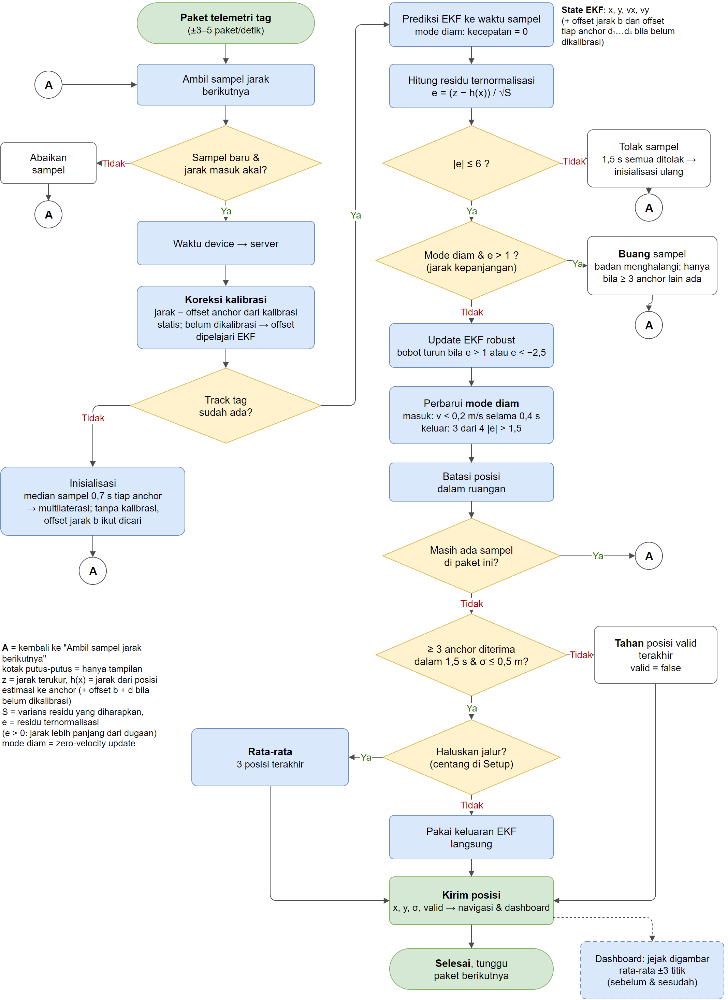

# Algoritma Positioning

Dokumen ini menjelaskan algoritma yang **benar-benar jalan** di server
(`server/tracker.py`), yaitu **CALF-UWB**. Fokusnya algoritma inti; algoritma
pendukung cukup digambarkan garis besarnya.

- Penurunan rumus, hasil uji lengkap, pembahasan catatan bimbingan, dan
  rujukan per bagian: [`algorithm-deep-understanding.md`](algorithm-deep-understanding.md).
- Riset, varian pembanding, dan ide yang tidak dipakai server: [`riset/`](riset/README.md).
- Arti setiap istilah: [Istilah](#istilah) di akhir dokumen.

Konvensi: koordinat lantai `(x, y)` dalam meter dari pojok 0,0 (anchor A2),
`z` = tinggi. Anchor = node tetap; tag = node di troli.

---

## Masalah yang diselesaikan

1. **Jarak UWB berisik dan kadang meleset jauh.** Derau satu sampel DS-TWR
   ±6–12 cm. Tubuh orang atau pantulan bisa menambah puluhan sentimeter, dan
   sesekali modul melaporkan angka mustahil.
2. **Semua jarak kelebihan jarak yang sama.** Delay antena DW1000 menambah
   ±75–100 cm ke setiap jarak. Selain itu tiap modul masih berbeda beberapa
   sentimeter dari modul lain.
3. **Data datang tidak serempak dan kadang terlambat.**
   - Laju sampel hanya ±2,5 per anchor per detik.
   - Data dikirim lewat WiFi secara berkelompok.
   - Kadang data macet beberapa detik.
4. **Saat troli diam, posisi bergetar beberapa sentimeter;** saat bergerak,
   garis lintasannya patah-patah.
5. **Saat data anchor berhenti, server dulu tetap mengeluarkan posisi.**
   Posisi itu tebakan dari 1–2 anchor dan bisa melenceng keluar ruangan
   (rekaman 23-10 `test-4`).

## Algoritma inti: CALF-UWB

**CALF-UWB — *Correction-Aware Layered Filter for UWB Indoor Positioning*.**
Di hasil studi algoritma ini disebut "Rekomendasi" = K + G + Z + L. Huruf-huruf
itu tetap dipakai sebagai nama komponennya:

| Lapisan | Komponen | Isi | Bagian |
|---|---|---|---|
| 1. Koreksi | **K** (kalibrasi statis) + offset b, dᵢ | Jarak dikoreksi dengan kalibrasi; tanpa kalibrasi, offset dipelajari EKF | §1 |
| 2. Filter robust | **G** (EKF lengkap) | EKF jarak miring, bobot Huber asimetris, tolak sampel \|e\| > 6, inisialisasi dengan pencarian offset | §1, §4 |
| 3. Batasan saat diam | **Z** (mode diam) + **L** (tolak jarak kepanjangan) | Kecepatan dikunci 0 saat berhenti; jarak yang kepanjangan dibuang | §2 |
| 4. Keluaran | Gerbang validitas + haluskan jalur (opsi) | Posisi hanya valid dari ≥ 3 anchor; rata-rata 3 posisi bila dicentang | §3, §5 |

"Berlapis" di sini berarti lapisan **fungsi**. Lapisan 2 dan 3 berjalan dalam
satu langkah EKF yang sama (Z mengubah prediksi, L memutuskan sampel dipakai atau
tidak). Jadi bukan dua filter yang dijalankan berurutan.

Ini satu-satunya algoritma di server. Nilainya tetap (tabel
[Parameter](#parameter-tetap)). Yang bisa diatur pengguna hanya:

- ukuran ruangan, tinggi tag, posisi anchor, dan kalibrasi (Setup → Room,
  Live → Inspector, Setup → Calibration);
- centang **Smooth the path** (Setup → Tracker), lihat §5.

Asal pilihan komponen-komponen ini dan varian yang dibandingkan ada di
[`riset/`](riset/README.md).



*Sumber yang bisa diedit: [`img/alur_algoritma.drawio`](img/alur_algoritma.drawio)
(dibuat oleh `docs/gambaran-sistem/gen_diagrams.py`).*

### 1. EKF pada jarak miring, dengan offset jarak

State dan model (`TagFilter`):

```
x = [px, py, vx, vy, b, d₁, d₂, d₃, d₄]
      b  = offset jarak bersama semua anchor (delay antena, ±0,75–1 m)
      dᵢ = offset tiap anchor terhadap yang lain (beberapa cm)

prediksi (model kecepatan Singer, τ = 1 s):
  a = e^(−Δt/τ),  g = τ(1 − a)
  px += g·vx,  py += g·vy,  vx *= a,  vy *= a
  P  = F P Fᵀ + Q(σa = 0,8 m/s²)

pengukuran satu anchor i (jarak miring 3D):
  h(x) = √((px − xᵢ)² + (py − yᵢ)² + Δzᵢ²) + b + dᵢ      Δzᵢ = z_anchor − z_tag
  e    = (z − h(x)) / √S                                   S = H P Hᵀ + R

update robust:
  |e| > 6             → sampel ditolak
  e > 1  atau e < −2,5 → R diperbesar (bobot turun, sampel tidak dibuang)
  K = P Hᵀ / S,  x += K·(z − h),  P = (I − KH) P (I − KH)ᵀ + K R Kᵀ
```

Poin-poin penting:

- **Setiap sampel dipakai satu kali,** pada waktu ukurnya sendiri.
- **Offset diambil dari kalibrasi statis (K) bila ada.** Bila setiap anchor
  punya titik kalibrasi (Setup → Calibration), jarak dikoreksi
  `r = (raw − offset) / scale` sebelum masuk EKF. Offset `b` dan `dᵢ` lalu
  dikunci 0 dan tidak dipelajari lagi. Di simulasi, kalibrasi menurunkan
  galat di rak dari 5,2 menjadi 3,9 cm.
- **Tanpa kalibrasi, offset dipelajari sendiri.**
  - `b` dihitung EKF, mirip bias jam penerima GPS: 4 anchor memberi lebih
    banyak persamaan daripada yang dibutuhkan untuk x dan y saja.
  - `dᵢ` dipelajari selama troli bergerak. Dari satu titik saja, offset ini
    tidak bisa dipisahkan dari posisi. Begitu troli melihat setiap anchor dari
    arah yang berbeda-beda, offsetnya bisa dipisahkan (*self-calibration*).
  - Server memilih sendiri: `calibrated = true` di `/api/v1/tracking` bila
    semua anchor sudah dikalibrasi.
- **Jarak yang terlalu panjang dipercaya lebih sedikit.** Halangan (tubuh,
  rak) hanya bisa membuat jarak **lebih panjang**, jadi batas Huber untuk
  e > 0 dibuat lebih ketat (1) daripada untuk e < 0 (2,5).

### 2. Mode diam (Z) dan tolak jarak kepanjangan (L)

Keduanya selalu aktif.

```
masuk mode diam : kecepatan EKF < 0,2 m/s selama 0,4 s
selama diam     : σa 0,8 → 0,05 m/s²; pengukuran semu v = 0 (σ 0,02 m/s)
                  jarak dengan e > 1 dibuang, bila ≥ 3 anchor lain diterima
                  dalam 1,5 s terakhir
keluar          : 3 dari 4 jarak terakhir |e| > 1,5
```

- **Mode diam (Z, *zero-velocity update*).** Saat troli berhenti, kecepatan
  dikunci 0 dan derau proses dikecilkan. Satu putaran jarak yang buruk tidak
  lagi menggeser posisi. Keluaran `still` = sedang dalam mode diam.
- **Tolak jarak kepanjangan (L).** Selama mode diam, jarak yang lebih panjang
  dari perkiraan lebih dari 1σ dibuang, bukan hanya diturunkan bobotnya.
  Alasannya, badan orang hanya bisa memperpanjang jarak.
- **Pengaman L.** Penolakan hanya terjadi selama anchor lain masih cukup
  untuk menghitung posisi. Bila koordinat anchor di denah salah, satu anchor
  bisa terus terbaca kepanjangan. Tanpa pengaman ini posisi menjadi tidak valid
  (rekaman `test-2`: ketersediaan turun ke 78%, dengan pengaman kembali 98%).
- **Saat bergerak** posisi = keluaran EKF langsung, tanpa jeda tambahan.

### 3. Gerbang validitas dan tahan posisi

```
valid ⇔ ≥ 3 anchor berbeda punya sampel diterima dalam 1,5 s terakhir
        dan margin error σ ≤ 0,5 m dan data terbaru berumur ≤ 1,5 s
tidak valid → keluarkan posisi valid TERAKHIR (held = true, valid = false)
```

Satu atau dua anchor tidak bisa menentukan posisi 2D. API navigasi ikut
menyatakan `valid: false`, sehingga troli tidak dikemudikan dengan posisi
tebakan.

### 4. Inisialisasi dengan pencarian offset

Waktu server baru menyala, offset `b` belum diketahui. Kalau `b` dianggap 0,
padahal aslinya ±1 m, fix pertama salah tempat dan track terkunci di posisi
yang salah. Kesalahan ini terlihat saat rekaman diputar ulang dari
tengah-tengah.

Langkah inisialisasi:

1. Ambil median sampel 0,7 s terakhir tiap anchor.
2. Cari `b` dari −0,5 sampai 1,5 m:
   - langkah 5 cm, lalu diperhalus 1 cm;
   - untuk tiap nilai `b`, hitung multilaterasi (x, y);
   - pilih `b` dengan residu terkecil.
3. Hasilnya hanya dipakai bila residu ≤ 30 cm dan posisinya di dalam ruangan.

### 5. Haluskan jalur (satu-satunya pilihan, Setup → Tracker)

```
centang "Smooth the path" → posisi = rata-rata 3 keluaran EKF terakhir
                            (tidak melewati jeda data > 4 s)
tidak dicentang           → posisi = keluaran EKF langsung
```

- Default: **dicentang**. Disimpan di `scene.json` (`"tracking": {"smooth": 1}`)
  dan bisa diubah lewat `PUT /api/v1/tracking {"smooth": true|false}`.
- Simulasi, bacaan di rak (kosong / sepi / ramai), dengan kalibrasi:
  - tanpa haluskan: 3,0 / 3,4 / 5,4 cm, galat bergerak 23,2 cm;
  - dengan haluskan: 3,1 / 3,5 / 5,5 cm, galat bergerak 34,5 cm.
- Garis ±3× lebih mulus, tapi tertinggal ±11 cm lebih banyak saat troli
  berjalan. Untuk navigasi yang butuh posisi paling baru, matikan centangnya.

---

## Algoritma pendukung (garis besar)

| Algoritma | Fungsi | Di mana |
|---|---|---|
| Dedup sampel | Setiap pengukuran dipakai sekali | `Engine.ingest` |
| Sinkronisasi jam | `millis()` device dipetakan ke waktu server | `ClockSync` |
| Satu sumber per tag | Salinan jarak dari anchor hanya dipakai bila tag diam > 10 s | `Engine.ingest` |
| Uji jarak mustahil | Jarak > sudut terjauh ruangan + 1,5 m dibuang | `Engine._process` |
| Kalibrasi manual per anchor | `r = (raw − offset) / scale` dari titik yang diukur meteran laser | `Engine.correct`, `/api/v1/calibration` |
| Inisialisasi ulang | 1,5 s tanpa sampel diterima → mulai lagi dari geometri | `_process` |
| Batas ruangan | Posisi dijepit ke ruangan ± 0,5 m | `_clamp_to_room` |
| NLOS dari denah | Jalur yang menembus obstacle mendapat σ lebih besar | `scene.py` |
| Peringatan posisi anchor | `dᵢ` > 20 cm → anchor itu kemungkinan salah posisi di denah | `estimate` (`offset_warning`) |

## Tampilan di dashboard

Semua elemen 3D sekarang mengikuti angka sebenarnya. Legenda di pojok kanan
bawah viewport menjelaskan elemen mana yang berskala nyata.

| Elemen | Arti |
|---|---|
| Lantai dan grid | Persis ukuran ruangan; garis tiap 1 m dari pojok 0,0 (tipis tiap 0,5 m). Penggaris di keempat sisi berakhir dengan panjang sebenarnya |
| Lingkaran di sekitar tag | Margin error ±1σ, **berskala nyata** (±2 dari 3 posisi ada di dalamnya) |
| Lingkaran putus-putus | Jarak yang diukur tiap anchor, **berskala nyata**. Titik temunya = posisi |
| Tiang anchor | Dari lantai sampai tinggi anchor sebenarnya |
| Warna tiang anchor | Kondisi anchor: hijau OK · kuning periksa (tidak ada jarak, residu besar, WiFi mati, atau offset > 20 cm) · merah masalah (terhalang / jarak ditolak) · abu-abu offline. Alasannya tertulis di label; klik anchor untuk detail |
| Garis jejak | Rata-rata ±3 titik sebelum dan sesudah (hanya gambar; posisi live tidak ditunda) |
| Garis tegak + silang di lantai (centang Setup → View → *Show coordinates*) | Titik lantai tepat di bawah pusat tag, **berskala nyata**. X / Y tertulis di sebelahnya (meter, 2 desimal = cm). Dua garis tipis dari silang ke penggaris tepi y = 0 (merah, membaca X) dan x = 0 (hijau, membaca Y). Bisa dibandingkan langsung dengan tanda lakban di lantai asli |
| Kepala tag dan anchor | Penanda, bukan ukuran asli |

---

## Hasil

### Simulasi

Troli robot berjalan sendiri di antara pembeli, ruangan 9,5 × 5,9 m, 4 anchor,
laju ranging seperti hardware, 20 rute per dunia (`tools/window_study.py`).
Bacaan di rak = galat posisi pada detik terakhir setiap berhenti.

| CALF-UWB | Bacaan di rak: kosong / sepi / ramai | Galat bergerak |
|---|---|---|
| **Dengan kalibrasi (K)** | **3,0 / 3,4 / 5,4 cm** | 23,2 cm |
| Dengan kalibrasi + haluskan jalur | 3,1 / 3,5 / 5,5 cm | 34,5 cm |
| Belum dikalibrasi (offset dipelajari) | 3,5 / 4,7 / 7,4 cm | – |

### Data rekaman nyata

Rekaman diputar ulang lewat CALF-UWB dengan pengaturan server (haluskan jalur
dicentang; belum dikalibrasi, jadi offset dipelajari sendiri). Rekaman ini
**tidak punya ground truth**, jadi yang diukur hanya kestabilan.

| Rekaman | Keadaan | Sebaran diam CEP50 / CEP95 | Kegoyahan saat bergerak | Valid |
|---|---|---|---|---|
| `statis-final` | Tag diam, ruangan 2,6 × 1,3 m | 0,2 / 0,3 cm | – | 82% |
| `verifikasi-final` | Tag diam | 0,2 / 0,3 cm | – | 96% |
| `statis-malam-20mnt` | Tag diam 20 menit, tanpa orang | 0,3 / 0,6 cm | – | 98% |
| `test-1` | Bergerak, ruangan 9,5 × 5,9 m | 1,3 / 2,1 cm | 8,8 cm | 99% |
| `test-2` | Bergerak | 0,6 / 1,1 cm | 4,7 cm | 98% |
| `test-3` | Rekaman pendek, hampir tidak bergerak | 1,2 / 2,1 cm | 0,2 cm | 98% |
| `test-4` | Bergerak | 0,3 / 0,5 cm | 10,7 cm | 97% |

- **Rata-rata empat rekaman 23-10:** CEP95 1,4 cm, kegoyahan 6,1 cm, valid
  98%, tidak ada posisi di luar ruangan.
- **Valid di bawah 100%** berarti saat itu posisi ditahan (HOLD): kurang dari 3
  anchor punya jarak baru, atau σ > 0,5 m.
- **Dua rekaman 16-10 di ruangan 9,8 × 6,8 m tidak dimasukkan.** Scene-nya salah
  setting: tinggi tag 2,0 m, lebih tinggi dari anchor (1,74 m).

### Target 2–4 cm

| Ukuran | Hasil | Status |
|---|---|---|
| **Presisi** (sebaran saat diam) | CEP95 1,4 cm (rekaman 23-10, CALF-UWB) | Tercapai |
| **Akurasi** saat diam, tanpa orang | 3,0 cm (simulasi, final) | Tercapai |
| **Akurasi** saat diam, sedikit pembeli | 3,4 cm (simulasi, final) | Tercapai |
| **Akurasi** saat diam, ramai pembeli | 5,4 cm (simulasi, final) | Hampir |

Halangan tubuh pembeli membuat jarak lebih panjang ke anchor di balik badan.
Mode diam dan tolak jarak kepanjangan mengurangi sebagian besarnya tanpa
hardware tambahan. Sisanya lebih ke pemasangan, yaitu tag dipasang tinggi di
tiang troli. Detail di dokumen mendalam §9.

---

## Parameter tetap

Nilai algoritma tetap dan tidak muncul di Setup, supaya pengguna hanya
mengisi yang memang harus diukur. Alasan tiap nilai tertulis di
`server/tracker.py` (`PARAMS`).

| Parameter | Nilai | Arti |
|---|---|---|
| `sigma_a` | 0,8 m/s² (0,05 saat diam) | Seberapa cepat troli boleh berubah kecepatan |
| `sigma_r` | 0,12 m | Derau satu jarak |
| `vel_tau_s` | 1,0 s | Berapa lama kecepatan dipertahankan saat data berhenti |
| `huber_k` / `huber_k_long` / `gate` | 2,5 / 1,0 / 6 | Mulai turunkan bobot (jarak pendek / jarak panjang) / tolak sampel |
| Mode diam | masuk < 0,2 m/s selama 0,4 s; keluar 3 dari 4 \|e\| > 1,5 | `ZUPT_*` di `tracker.py` |
| `still_long` | 1,0σ | Ambang buang jarak kepanjangan saat diam |
| `min_anchors`, `fresh_ms`, `valid_sigma` | 3, 1500 ms, 0,5 m | Gerbang validitas |
| `reinit_ms`, `room_margin` | 1500 ms, 0,5 m | Mulai ulang tanpa data / batas ruangan |
| `smooth_window`, `window_ms` | 3 posisi, 4000 ms | Ukuran rata-rata "Smooth the path" |

Yang bisa diubah pengguna:

| Pengaturan | Di mana | Catatan |
|---|---|---|
| Ukuran ruangan, tinggi tag `tag_z` | Setup → Room | Ukur dengan meteran; salah ukur `tag_z` menggeser semua posisi |
| Posisi dan tinggi anchor | Live → Inspector (klik anchor) | Offset > 20 cm memunculkan peringatan "periksa posisi" |
| Titik kalibrasi | Setup → Calibration | Taruh tag di titik yang diukur, isi x, y, lalu Apply |
| Haluskan jalur | Setup → Tracker | Satu centang, lihat §5 |

## Peta kode

| Bagian | File / fungsi |
|---|---|
| Nilai tetap + alasannya | `server/tracker.py` `PARAMS`, `tracking_params` |
| EKF, mode diam, tolak jarak kepanjangan | `tracker.py` `TagFilter` (`predict`, `update`, `_standing_mode`) |
| Kalibrasi atau offset dipelajari | `tracker.py` `Engine.correct`, `Engine._offset_policy` |
| Inisialisasi dengan pencarian offset | `tracker.py` `multilaterate_with_offset`, `Engine._bootstrap` |
| Haluskan jalur | `tracker.py` `Engine._reported` |
| Gerbang validitas, posisi ditahan | `tracker.py` `Engine.estimate` |
| Satu-satunya pengaturan (`smooth`) | `server/app.py` `api_tracking` |
| `valid` untuk navigasi | `server/app.py` `_nav_position_doc` (`NAV_STALE_MS`) |
| Tampilan 3D, kondisi anchor, istilah | `server/static/app.js` (`buildRoom`, `anchorStatus`, `TIP`) |
| Putar ulang rekaman | `tools/evaluate.py LOG --replay` |

---

## Istilah

| Istilah | Arti |
|---|---|
Hanya istilah yang dipakai sistem ini, dikelompokkan supaya mudah dicari.
Singkatan ditulis dengan kepanjangannya. Istilah yang hanya muncul di riset ada
di [`riset/README.md`](riset/README.md#istilah-riset).

### Sistem dan hardware

| Istilah | Arti |
|---|---|
| **UWB** (*Ultra-Wideband*) | Radio pita sangat lebar. Waktu tempuh sinyalnya bisa diukur sangat teliti, sehingga jarak bisa diukur sampai sentimeter |
| **DW1000** | Chip UWB (Decawave, sekarang Qorvo) yang dipakai di setiap node |
| **ESP32** | Mikrokontroler di setiap node: menjalankan firmware, WiFi, layar |
| **Node** | Satu papan ESP32 + DW1000 |
| **Anchor** | Node tetap di pojok ruangan, posisinya diukur dengan meteran |
| **Tag** | Node yang menempel di troli; posisinya yang dicari |
| **Firmware** | Program di ESP32 (`src/`) |
| **OLED** | Layar kecil di papan; menampilkan jarak terbaru |
| **OTA** (*Over-The-Air*) | Memperbarui firmware lewat WiFi tanpa kabel |
| **Server** | Program Python (`server/`) yang menerima data, menghitung posisi, dan menampilkan dashboard |

### Pengukuran jarak

| Istilah | Arti |
|---|---|
| **Jarak (range)** | Jarak tag ke satu anchor hasil UWB, garis lurus 3D (termasuk beda tinggi). Disebut juga jarak miring |
| **ToF** (*Time of Flight*) | Waktu tempuh sinyal dari satu node ke node lain; jarak = ToF × kecepatan cahaya |
| **TWR** (*Two-Way Ranging*) | Mengukur ToF dengan pesan bolak-balik, sehingga jam kedua node tidak perlu sama |
| **ADS-TWR** (*Asymmetric Double-Sided TWR*) | TWR dengan dua kali kirim-balas: galat beda jam saling membatalkan, tetap teliti walau jeda balasan kedua sisi berbeda. **Yang dipakai firmware** |
| **Delay antena** | Waktu sinyal di dalam rangkaian antena; tanpa kalibrasi menambah ±75–100 cm ke setiap jarak |
| **Beda jam (*clock drift*)** | Kristal setiap node berdetak sedikit berbeda; membuat ToF sedikit salah |
| **raw** | Jarak mentah dari firmware. **Yang dipakai server** |
| **range** (kolom paket) | Jarak yang sudah dihaluskan firmware (tolak lompatan > 5 m + median 3 + EMA). Hanya untuk OLED |
| **LOS / NLOS** (*(Non-)Line of Sight*) | Jalur sinyal bebas / terhalang (badan, rak). NLOS membuat jarak lebih **panjang** |

### CALF-UWB dan komponennya

| Istilah | Arti |
|---|---|
| **CALF-UWB** | *Correction-Aware Layered Filter for UWB Indoor Positioning*: nama algoritma di server = K + G + Z + L + keluaran |
| **K** (Kalibrasi statis) | Lapisan koreksi: `jarak = (raw − offset) / scale` dari titik-titik yang diukur dengan meteran |
| **G** (nama varian di studi pemilihan algoritma) | EKF lengkap: jarak miring, offset b dan d, bobot Huber asimetris, tolak \|e\| > 6, inisialisasi dengan pencarian offset |
| **Z** (*Zero-velocity*, mode diam) | Saat troli berhenti (< 0,2 m/s selama 0,4 s), kecepatan dikunci 0 supaya posisi tidak bergoyang |
| **L** (*Long*, tolak jarak kepanjangan) | Saat diam, jarak yang lebih panjang dari perkiraan lebih dari 1σ dibuang (badan menghalangi) |
| **ZUPT** (*Zero-velocity UPdaTe*) | Nama umum teknik di balik Z |
| **Offset jarak (b)** | Kelebihan jarak yang sama di semua anchor karena delay antena DW1000 (±75–100 cm). Dihitung otomatis dan dikurangkan. Dulu disebut "bias" |
| **Offset anchor (d)** | Selisih satu anchor terhadap anchor lain (beberapa cm). Lebih dari 20 cm = posisi anchor di denah kemungkinan salah |
| **EKF** (*Extended Kalman Filter*) | "Otak" penghitung posisi: menggabungkan model gerak troli dengan setiap jarak baru, sambil menghitung seberapa yakin hasilnya |
| **State** | Isi yang dilacak EKF: posisi x, y, kecepatan vx, vy, dan offset b, d₁…d₄ |
| **Prediksi / Update** | Dua langkah EKF: geser posisi sesuai kecepatan, lalu koreksi dengan jarak baru |
| **Model Singer** | Model gerak di mana kecepatan pelan-pelan meluruh bila tidak ada data baru |
| **Residu** | Jarak terukur − jarak yang diharapkan dari posisi dan offset. Mendekati 0 = anchor itu sepakat dengan yang lain |
| **e (residu ternormalisasi)** | Residu dibagi simpangan yang diharapkan; dipakai untuk menolak / menurunkan bobot sampel |
| **Huber** | Cara menurunkan bobot sampel yang menyimpang tanpa membuangnya |
| **Huber asimetris** | Jarak kepanjangan (e > 1) lebih cepat diturunkan bobotnya daripada jarak kependekan (e < −2,5) |
| **Gerbang validitas** | Posisi hanya valid bila ≥ 3 anchor diterima dalam 1,5 s terakhir dan σ ≤ 0,5 m |
| **HOLD** | Posisi ditahan karena data kurang (< 3 anchor); ditandai tidak valid |
| **Margin error (±σ)** | Ketidakpastian posisi menurut EKF: ±2 dari 3 posisi berada dalam radius ini. Bukan galat sebenarnya; galat dari posisi anchor yang salah ketik tidak termasuk |
| **Multilaterasi** | Menghitung posisi dari beberapa jarak sekaligus; dipakai untuk posisi pertama (inisialisasi) |
| **Inisialisasi (*bootstrap*)** | Posisi pertama sebelum EKF berjalan, dari median jarak 0,7 s terakhir |
| **Jepit ke ruangan** | Posisi tidak boleh lebih dari 0,5 m di luar ruangan |
| **Haluskan jalur** | Pilihan di Setup: posisi yang ditampilkan = rata-rata 3 posisi terakhir |

### Pengolahan sinyal dan jendela

| Istilah | Arti |
|---|---|
| **Median 3** | Nilai tengah dari 3 sampel terakhir; membuang satu lonjakan |
| **EMA** (*Exponential Moving Average*) | Rata-rata berjalan: nilai baru dicampur sebagian (di firmware 35%) dengan nilai lama |
| **Jendela (*window*)** | Sekelompok sampel terakhir yang dirata-rata / diambil mediannya |
| **Geser-1 (*sliding*)** | Jendela maju satu sampel tiap kali: 1–3, 2–4, 3–5, … Dipakai "haluskan jalur" |

### Ukuran hasil

| Istilah | Arti |
|---|---|
| **Ground truth** | Posisi sebenarnya: dari simulasi, atau titik yang diukur meteran laser |
| **Presisi** | Seberapa rapat posisi saat diam (tidak butuh posisi benar) |
| **Akurasi** | Seberapa dekat posisi dengan posisi benar (butuh ground truth) |
| **Galat** | Jarak antara posisi hasil hitung dan posisi benar |
| **RMSE** (*Root Mean Square Error*) | Rata-rata galat di mana galat besar lebih berpengaruh; ditampilkan di uji statis (Setup → Calibration) |
| **CEP50 / CEP95** (*Circular Error Probable*) | Radius yang memuat 50% / 95% posisi |
| **Kegoyahan** | Seberapa patah-patah garis (RMS beda-kedua posisi berurutan) |
| **Bacaan di rak** | Galat posisi saat troli berhenti di depan rak (ukuran utama target 2–4 cm) |
| **Galat bergerak** | Galat rata-rata selama troli berjalan |
| **Valid (%)** | Bagian waktu di mana posisi valid (tidak HOLD) |
| **Kosong / sepi / ramai** | Tiga dunia simulasi: tanpa pembeli, sedikit pembeli, banyak pembeli |

### Jaringan

| Istilah | Arti |
|---|---|
| **Paket telemetri** | Kiriman tag ke server tiap 200 ms: daftar jarak + waktu ukurnya |
| **JSON** | Format teks paket dan API |
| **HTTP / REST API** | Cara kirim lewat permintaan web (`/api/v1/...`); yang dipakai saat ini |
| **MQTT** | Cara kirim lewat langganan topik dengan koneksi yang tetap terbuka; sedikit lebih cepat |
| **Broker** | Program perantara MQTT (misalnya Mosquitto) |
| **Latensi (jeda)** | Waktu dari jarak diukur sampai posisinya tampil |

## Rujukan singkat

| Bagian | Rujukan |
|---|---|
| EKF untuk UWB | Yao 2021, Krebs 2024 |
| Huber | Huber 1964 |
| Model Singer | Singer 1970 |
| Offset per anchor (self-calibration) | Hapsari 2025 (paper 09) |
| Bobot asimetris NLOS | Fan & Du 2022 (NLOS selalu memperpanjang jarak) |
| Mode diam (Z) | Ide *zero-velocity update* (Foxlin 2005) |
| Penempatan anchor | Kramarić 2025 |
| ADS-TWR (dipakai firmware) | Neirynck dkk. 2016, *An alternative double-sided two-way ranging method* |

Detail dan bagian mana yang didukung tiap rujukan ada di
[`algorithm-deep-understanding.md`](algorithm-deep-understanding.md#12-rujukan).
