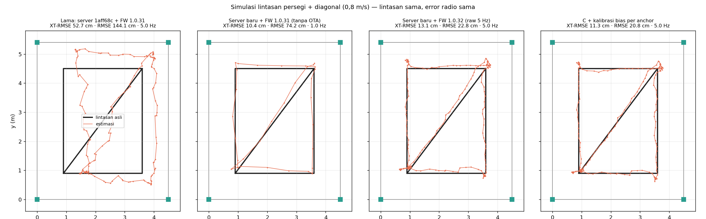

# Perbaikan Akurasi Posisi — Analisis, Perbaikan, dan Protokol Uji

Dokumen ini menjelaskan **kenapa lintasan tag zig-zag** padahal alat dibawa
lurus, apa yang diperbaiki, seberapa besar dampaknya (diukur), dan **bagaimana
menguji akurasi tanpa sistem motion-capture** (tanpa ground truth dinamis).

> Ringkas: masalah utamanya bukan di radio UWB, tapi di **cara data jarak
> diolah**. Server lama memakai data jarak yang sama berulang-ulang sebagai
> data baru, solver least-squares-nya mengeluarkan posisi tercermin, firmware
> hanya mengirim 1 sampel/detik yang sudah di-smoothing, dan bias jarak DW1000
> tidak pernah dikalibrasi. Pada simulasi dengan error radio yang sama, galat
> lintasan (cross-track RMSE) turun dari **52,7 cm → 11,3 cm** dan galat posisi
> (RMSE) dari **144 cm → 20,8 cm**. Di alat (tag diam, ruangan 2,63 × 1,26 m)
> CEP95 akhir **11,9 cm**, tanpa crash device (§1.1).

---

## 1. Akar masalah (temuan dari kode)

| # | Masalah | Lokasi lama | Akibat yang terlihat |
|---|---|---|---|
| 1 | **Pengukuran dipakai berulang.** Setiap paket yang masuk (dari tag *dan* tiap anchor, plus pesan MQTT per-range) menjalankan EKF ulang dengan **semua** jarak yang tersimpan (umur ≤ 5 s). Satu pengukuran fisik dipakai 5–10× seolah data baru. | `server/app.py` `recompute_positions()` | Kovarians EKF kolaps (filter "yakin" sampai mm) → gerakan nyata dianggap outlier; jarak dari waktu berbeda digabung seolah serentak → estimasi ditarik bergantian ke lingkaran tiap anchor = **zig-zag** |
| 2 | **Gate inovasi + self-heal.** Karena #1, pengukuran baik ditolak 3σ; setelah 8 siklus filter di-reset. | `recompute_positions()` | **Loncatan** posisi setelah jalan lurus |
| 3 | **Bug tanda least-squares.** Persamaan linear menghasilkan `−p`, bukan `p`: posisi (1,2; 3,7) keluar (−1,2; −3,7). Hanya 2 iterasi Gauss-Newton untuk "membetulkan". | `solve_2d()` (server) dan `src/solver.h` (firmware) | Fix awal / reset sering meleset jauh |
| 4 | **Firmware kirim 1 Hz, nilai ter-filter.** Telemetri tiap `update_ms × 5` = 1 s, isinya nilai terakhir per link (median-3 + EMA → lag ~0,5 s) dan nilai yang sama dikirim ulang tiap paket. | `src/main.cpp` loop / `buildTelemetry()` | Lintasan berupa poligon kasar yang tertinggal di belakang tag |
| 5 | **Proyeksi jarak ke lantai** `√(r² − dz²)`: memperbesar noise dekat anchor, dan saat noise membuat `r < dz` nilainya diganti `0,1·r` (salah besar). | `scene.horizontal_range()` | Posisi "tersedot" saat dekat anchor |
| 6 | **Bias jarak tidak dikalibrasi.** Antenna delay DW1000 dibiarkan default 16384, jadi tiap jarak kelebihan beberapa puluh cm. | `lib/DW1000` default | Lintasan **melebar/menyusut** dari bentuk aslinya |
| 7 | **MQTT buffer 256 byte.** PubSubClient menolak diam-diam semua paket > 256 B — telemetri batch tidak pernah sampai lewat MQTT. Slot REST juga **menimpa** batch yang belum terkirim. | `src/net.h`, `queueRest()` | Data hilang tanpa error |
| 8 | Dokumentasi menyatakan "menaikkan `sigma_r` = lebih percaya pengukuran" — **terbalik**. | `docs/ALGORITHMS.md` §10 | Salah arah saat tuning |

Bug #1 dan #3 direproduksi di simulasi dengan **kode server lama yang asli**
(diambil dari commit `1aff68c`), lihat §3.

### 1.1 Temuan saat uji di alat (16 Okt 2026, ruangan 2,63 × 1,26 m)

| # | Temuan | Bukti | Perbaikan |
|---|---|---|---|
| 9 | **Anchor restart sendiri tiap 1,5–3 menit.** Config yang dikirim server ke anchor memuat `last_seen` (berubah tiap paket), sehingga anchor menulis ulang seluruh NVS tiap 15 s. Selama flash ditulis cache dimatikan, sedangkan ISR DW1000 tidak di IRAM → crash. | Uptime anchor terus kembali ke 0; tag (yang config-nya tanpa `last_seen`) jarang. | Server tidak lagi mengirim field internal; firmware 1.0.32 hanya menulis NVS bila nilainya benar-benar berubah, dengan radio di-*quiesce*. |
| 10 | **Crash `panic` / `int_wdt` (interrupt watchdog).** ISR library DW1000 membaca register lewat SPI di dalam interrupt; di ESP32 transaksi SPI memakai mutex FreeRTOS → assert (`panic`) atau ISR menunggu bus yang sedang dipakai loop (`int_wdt`). | Field `reset` baru di status (FW 1.0.32): 4 crash anchor dalam 170 s, semuanya `panic`/`int_wdt`. | Library (`lib/DW1000`, FW 1.0.33): ISR di IRAM hanya memberi tanda; pemrosesan SPI dipindah ke `DW1000.poll()` di loop. |
| 11 | **Laju ranging hanya ~2,3 sampel/s per anchor** (seharusnya ~6) dengan jeda sampai 9,5 s. | Rekaman `debug-fw132`: `seq` hampir tanpa celah (pengiriman beres), tapi pengukurannya sendiri jarang. | Sebagian besar karena #10 (anchor yang crash hilang dari siklus). Catatan: protokol library mengirim RANGE hanya bila anchor *terakhir* di daftar membalas, jadi satu anchor bermasalah menggagalkan satu siklus untuk semua. |
| 12 | **Bias jarak +0,75 m** di semua anchor (antenna delay default). | Jarak terdekat terukur 1,91 m, padahal maksimum yang mungkin di ruangan itu 1,51 m. | Diestimasi online (`b`); kalibrasi titik menghilangkan sisa ±8 cm per anchor. |
| 14 | **Setelah device restart (mis. OTA), tag diabaikan beberapa menit.** `millis()` mulai lagi dari 0, tapi tanda "sampel sudah dipakai" per device tidak di-reset. | Rekaman `fw133-stabil`: 165 s tanpa estimasi padahal sampel masuk. | Restart dideteksi dari `millis()` yang mundur; tanda dedup device itu dihapus. |
| 15 | **Lonjakan posisi dari salinan anchor.** Anchor mengirim sampel link-nya sendiri sekali per detik; dicampur dengan data tag, filter menerima 3–5 update beruntun dari satu anchor. | 26 lonjakan > 25 cm dalam 5 menit (tag diam), hampir semuanya "via anchor". | Salinan anchor hanya dipakai bila tag sendiri tidak mengirim ≥ 3 s. Hasil pada data yang sama: lonjakan 26 → 8, CEP95 23,0 → 17,7 cm, maks 110 → 71 cm. |
| 16 | **6 % sampel mentah mustahil** (37–189 m di ruangan 2,6 m). | 99 dari ~1.600 sampel. | Dibuang bila melebihi jarak ke pojok ruangan terjauh + 1,5 m. |
| 17 | **Uplink WiFi tag macet ~3 s lalu mengirim tumpukan sampel berumur 1,7 s.** Modem-sleep ESP32 (default) menahan paket; RTT LAN ~60 ms. Saat macet > 3 s server beralih ke salinan anchor → lonjakan sampai 120 cm. | Rekaman `statis-final`. | FW 1.0.34: `WiFi.setSleep(false)` (RTT 61 → 4–8 ms); salinan anchor baru dipakai setelah 10 s tanpa data tag. |
| 18 | **Estimasi "meluncur" saat data terputus** — model kecepatan konstan mengekstrapolasi noise kecepatan ±0,15 m/s selama jeda. | Lonjakan setelah jeda 3 s. | Model kecepatan Singer (τ = 1 s). Pada 2 rekaman statis: CEP95 16,0 → 13,8 cm dan 13,8 → 11,9 cm; di simulasi XT 15,3 → 13,2 cm (RMSE +2 cm karena sedikit lebih lambat). |
| 13 | **Tag diam ikut "bergerak" saat orang bergerak di dekatnya.** (lihat baris di bawah) Tubuh menyerap UWB → jarak anchor terdekat bertambah 4–5 cm. Ruangan sempit (1,26 m) dengan anchor di pojok membuat sumbu Y ~2× lebih sensitif: σ_x 2,8 cm vs σ_y 5,8 cm, simpangan maks ~21 cm. | Rekaman `debug-kos`. | Bukan bug — efek fisika (NLOS tubuh). Untuk uji statis tidak ada orang bergerak di area; bisa dijadikan eksperimen tersendiri. |


### 1.2 Hasil di alat — tag diam, ruangan 2,63 × 1,26 m, 4 anchor

Rekaman 3–5 menit dengan tag diam di tripod, tanpa kalibrasi titik (bias
diestimasi online). Angka di bawah adalah **presisi** (sebaran di sekitar
posisi rata-rata); **akurasi** butuh posisi tag yang diukur dengan meteran
laser (§4.3).

| Tahap | Crash device | Estimasi/s | σ x / σ y | CEP50 | CEP95 | Maks | Lonjakan > 25 cm |
|---|---|---|---|---|---|---|---|
| FW 1.0.33, tracker awal (`fw133-stabil`, replay) | 0 | 2,2 | 6,9 / 12,2 cm | 7,3 cm | 23,0 cm | 110 cm | 26 / 5 mnt |
| + satu sumber per tag, buang jarak mustahil (`statis-final`) | 0 | 1,8 | 6,2 / 16,9 cm | 6,6 cm | 20,2 cm | 120 cm | 5 / 3 mnt |
| **FW 1.0.34 + model Singer + tahan sumber 10 s (`verifikasi-final`)** | **0** | **3,0** | **3,5 / 6,3 cm** | **4,9 cm** | **13,6 cm** | **32 cm** | **4 / 3 mnt** |

Sebelum FW 1.0.33, anchor crash 4× dalam 170 s. Pada FW 1.0.34 umur sampel
terbaru saat tiba di server median 80 ms (sebelumnya sampai 1,7 s) dan RTT
WiFi ke tag 3–4 ms (sebelumnya ~60 ms). Laju ranging masih ~2,5–3
sampel/s per anchor (batas protokol library, lihat #11).
---

## 2. Perbaikan

### 2.1 Server — `server/tracker.py` (baru)

1. **Setiap sampel dipakai tepat sekali, pada waktu ia diukur.** Sampel
   dideduplikasi per `(pelapor, anchor, tag)` berdasarkan timestamp device.
   Jam `millis()` tiap device dipetakan ke jam server dengan offset latensi
   minimum (`ClockSync`), lalu EKF memprediksi ke waktu itu sebelum update.
2. **Satu sumber per link.** Tag dan anchor sama-sama melaporkan hasil TWR yang
   sama; salinan dari tag dipakai (semua jaraknya satu jam), salinan anchor
   hanya bila tag tidak melaporkan link itu selama 3 s.
3. **Model pengukuran jarak miring (slant range)**, tanpa proyeksi:
   `h(x) = √((px−ax)² + (py−ay)² + dz²) + b`, `dz = z_anchor − z_tag`.
4. **State bias bersama `b`** (`x = [px, py, vx, vy, b]`). Delay antena yang
   belum dikalibrasi menambah offset yang hampir sama ke semua jarak. Dengan 4
   anchor ada 2 pengukuran lebih banyak dari yang dicari (px, py), jadi offset
   ini **teramati dan diestimasi online** — prinsipnya sama dengan *clock bias*
   pada GPS. Aktif hanya bila anchor ≥ 3.
5. **Update robust (Huber) alih-alih gate keras.** `|ν| > 2,5` → noise
   pengukuran dibesarkan; `|ν| > 6` → ditolak. Tidak ada sampel diterima
   selama 1,5 s → inisialisasi ulang dari multilaterasi.
6. **Bootstrap** dari semua anchor (Gauss-Newton pada model miring), baru
   ditampilkan setelah menerima 2 sampel per anchor.
7. **Kalibrasi per anchor** `r = (raw − bias_i) / scale_i` dari titik statis
   yang diukur dengan meteran laser (§4.2).
8. **Perekam sesi** (`server/recorder.py`) — semua paket mentah + estimasi ke
   `server/logs/*.jsonl`, bisa **diputar ulang** dengan parameter lain.

### 2.2 Firmware 1.0.32

- Setiap hasil TWR masuk antrean dan dikirim **sekali**, lengkap dengan `raw`
  (tanpa filter), `ts` saat diukur, dan `seq`.
- Tag mengirim tiap `update_ms` (200 ms = 5 Hz); anchor tiap 1 s.
- Slot REST tidak lagi menimpa batch yang belum terkirim (sampel tetap di
  antrean); buffer MQTT 4 kB.
- Bug tanda di `solver.h` diperbaiki; EKF lokal tidak memakai ulang jarak lama.

### 2.3 Parameter default

| Parameter | Lama | Baru | Catatan |
|---|---|---|---|
| `sigma_a` (noise percepatan) | 1,0 m/s² | 0,8 m/s² | lebih kecil = lebih halus, lebih lambat di belokan |
| `sigma_r` (noise jarak LOS) | 0,15 m | 0,12 m | lebih kecil = **lebih** percaya pengukuran |
| gate | 3σ (tolak) | Huber 2,5σ / tolak 6σ | |
| `vel_tau_s` (model kecepatan) | ∞ (CV murni) | 1,0 s (Singer) | kecepatan meluruh saat data terputus; lebih kecil = lebih tenang tapi lebih lambat |
| laju update | 1 Hz | ~5 Hz (tag) | |
| bias jarak | — | estimasi online + kalibrasi | |

Semua bisa diubah lewat `PUT /api/v1/tracking` tanpa restart, dan diuji ulang
pada data rekaman yang sama (`tools/evaluate.py --replay --set sigma_a=1.0`).

---

## 3. Hasil simulasi (sebelum vs sesudah)

`python tools/simulate.py --runs 30` — lintasan persegi + diagonal 17,1 m,
0,8 m/s, berhenti 2 s di tiap sudut; ruangan 4,5 × 5,4 m, 4 anchor di pojok
(z = 2,2 m), tag 1,0 m. Model radio: TWR pada laju poll library DW1000 (164 ms),
noise 6 cm, bias antena 20 ± 8 cm per anchor, 4 % outlier NLOS (+0,3…1,5 m),
bayangan tubuh pembawa (+15 cm untuk anchor di belakang), 8 % paket hilang,
jam device terpisah, delay REST 20–170 ms. **Keempat pipeline menerima
pengukuran radio yang sama persis.**



| Pipeline | RMSE | XT-RMSE | XT-P95 | XT-max | Update | Loncat > 0,5 m / run |
|---|---|---|---|---|---|---|
| **A** Lama: server `1aff68c` + FW 1.0.31 | 144,1 cm | 52,7 cm | 94,0 cm | 112,2 cm | 5 Hz* | 7,3 |
| **B** Server baru + FW 1.0.31 (belum OTA) | 74,2 cm | 10,4 cm | 19,6 cm | 26,2 cm | 1 Hz | 20,4 |
| **C** Server baru + FW ≥ 1.0.32 | 22,8 cm | 13,1 cm | 25,5 cm | 33,9 cm | 5 Hz | 0,0 |
| **D** C + kalibrasi bias per anchor | **20,8 cm** | **11,3 cm** | **22,4 cm** | **29,0 cm** | 5 Hz | 0,0 |

- **RMSE** = jarak ke posisi sebenarnya pada detik yang sama (termasuk lag).
- **XT** (*cross-track*) = jarak ke lintasan yang dijalani (ukuran kelurusan).
- \* A memperbarui posisi di setiap paket, tapi dengan data lama yang dipakai ulang.

Cara membaca: **B** terlihat paling "lurus" (XT 10,6 cm) karena hanya 1 titik
per detik dan sudah di-smoothing di firmware — tapi posisinya **tertinggal
~0,7 m** di belakang tag (RMSE 73 cm) dan melompat 20× per putaran. Untuk
navigasi troli yang dibutuhkan C/D: real-time, tanpa lompatan.

Ablasi (12 run dengan seed lain, satu faktor diubah per baris):

| Kondisi | XT-RMSE C | XT-RMSE D |
|---|---|---|
| default | 12,5 cm | 11,5 cm |
| estimasi bias online dimatikan | 33,0 cm | 14,9 cm |
| tanpa bayangan tubuh | 7,5 cm | 5,3 cm |
| tanpa bayangan tubuh & outlier | 6,8 cm | 4,0 cm |

Artinya: (1) **estimasi bias online** adalah perbaikan terbesar kalau belum
kalibrasi; (2) sisa galat terbesar adalah **badan pembawa tag** yang
menghalangi anchor di belakangnya — tidak bisa dihilangkan filter, jadi saat
uji **pegang tag tinggi / pasang di tiang**.

> Catatan kejujuran: angka di atas berasal dari **model error yang diasumsikan**
> (`tools/simulate.py`, semua konstanta tertulis di bagian atas file). Simulasi
> membuktikan perbaikan logika pengolahan data; akurasi alat sebenarnya harus
> diukur dengan protokol §4.

---

## 4. Protokol uji tanpa ground truth dinamis

Tanpa motion-capture, posisi sebenarnya *pada tiap detik* memang tidak
diketahui. Tapi ada dua hal yang **bisa** diketahui dengan pasti, dan itu yang
dipakai sebagai ground truth:

1. **Titik statis** — tag diam di titik yang koordinatnya diukur dengan meteran
   laser → galat posisi sesungguhnya (akurasi, presisi, CEP).
2. **Lintasan yang diketahui** — tag dibawa menyusuri garis lakban yang
   ujung-ujungnya diukur → galat **cross-track** (jarak tiap estimasi ke garis).
   Ini tidak membutuhkan "kapan tag di mana", hanya "tag pasti ada di garis
   ini", sehingga sah sebagai ground truth lintasan.

### 4.1 Persiapan pengukuran (meteran laser Sndway SW-DS70)

1. **Origin** `(0, 0)` = pojok lantai tepat di bawah anchor-4; sumbu **X**
   sepanjang dinding menuju anchor-3, sumbu **Y** menuju anchor-2.
2. Untuk tiap anchor ukur **x, y** (jarak tegak lurus ke dua dinding) dan
   **z** = tinggi *antena* dari lantai. Isi di editor 3D → **Save**.
   > Scene sekarang: semua anchor `z = 2,2 m`, tapi tinggi ruangan tercatat
   > `2,0 m` — salah satunya pasti keliru. Galat 20 cm pada `z` anchor
   > membelokkan jarak sampai ~19 cm saat tag dekat anchor itu.
3. **Cek silang**: ukur jarak diagonal antar anchor dengan laser, bandingkan
   dengan jarak dari koordinat. Selisih > 3 cm berarti ada koordinat salah.
4. Ukur **tinggi tag** saat dipegang/dipasang → Setup → *Tag height above
   floor*. Gunakan tinggi yang sama selama semua uji (tongkat/tripod).
5. Foto tata letak + catat semua angka (untuk lampiran laporan).

### 4.2 Kalibrasi bias (± 10 menit)

1. Tandai 3 titik **berbeda jarak** ke anchor (mis. dekat tengah, dekat sisi
   A4–A3, dekat sisi A2–A5). Ukur x, y-nya.
2. Tag diam di titik (tripod/kursi, tinggi = *tag height*). Web UI → Setup →
   *Calibration & static test* → isi X, Y, 20 s, centang *Keep as calibration
   point* → **Measure here**. Ulangi untuk ketiga titik.
3. **Apply calibration.** Tabel akan menampilkan bias tiap anchor
   (nilai wajar: puluhan cm, positif).

### 4.3 Uji statis (akurasi dengan ground truth nyata)

5 titik grid yang **bukan** titik kalibrasi, masing-masing 30 s, *Keep as
calibration point* **tidak** dicentang. Catat per titik:

| Titik | x, y (m) | Mean error | σ (presisi) | RMSE | CEP50 | CEP95 |
|---|---|---|---|---|---|---|
| P1 | | | | | | |

Definisi: mean error = jarak rata-rata estimasi ke titik acuan (akurasi);
σ = sebaran estimasi di sekitar rata-ratanya (presisi);
CEP50/95 = radius yang memuat 50 %/95 % estimasi.

### 4.4 Uji dinamis (lintasan)

1. Lakban garis lurus A → B (≥ 3 m) dan satu persegi; ukur koordinat ujungnya.
2. Setup → *Record session* → nama mis. `garis-AB` → **Start recording**.
3. Bawa tag menyusuri garis, ± 0,5 m/s, 5× bolak-balik, tag tetap di tinggi
   yang sama dan di depan/atas badan. Tekan **Mark** saat tiba di A dan B
   (opsional, untuk memotong data).
4. **Stop recording**, lalu:

   ```bash
   python tools/evaluate.py server/logs/<file>.jsonl --path 0.80,1.00 3.60,4.40 --min-speed 0.1
   ```

   Keluaran: XT-RMSE, XT-P95, XT-max, plus **garis best-fit** (RMS ke garis
   lurus terbaik dan selisih sudutnya) — ukuran kelurusan yang sama sekali
   tidak bergantung pada ground truth. Grafik PNG disimpan di sebelah log.
5. Bandingkan parameter pada data yang sama:

   ```bash
   python tools/evaluate.py server/logs/<file>.jsonl --path ... --replay --set sigma_a=1.2
   ```

### 4.5 Yang dilaporkan

- Tabel uji statis (§4.3) + rata-rata.
- Tabel uji lintasan: XT-RMSE / P95 / max per lintasan, sebelum dan sesudah
  kalibrasi (`--replay` dengan scene tanpa kalibrasi bisa dibuat dengan
  `--set estimate_bias=0` untuk ablasi).
- Grafik lintasan dari `evaluate.py`.
- Grafik simulasi (§3) sebagai validasi metode.

---

## 5. Urutan kerja dengan alat

1. Jalankan server baru: `python server/app.py` (scene, kalibrasi, dan key OTA
   lama tetap terpakai).
2. Nyalakan semua board → Setup → *OTA firmware* → pilih
   `uwb-node-1.0.32.bin` → **Push to all online**. Cek di tab Devices semua
   sudah `1.0.32`. *(Kalau OTA gagal, server baru tetap jalan dengan firmware
   lama — hasilnya baris B pada tabel §3.)*
3. Masukkan koordinat anchor hasil ukur (§4.1) → Save.
4. Kalibrasi (§4.2) → Apply.
5. Uji statis (§4.3), uji lintasan (§4.4).
6. Klik tag di viewport: inspector menampilkan *Range offset* (estimasi `b`),
   *Samples*/s, dan *Residual* tiap anchor. Residual satu anchor yang
   konsisten besar = koordinat anchor itu salah atau jalurnya NLOS.

---

## 6. Batasan

- Bayangan tubuh (badan menghalangi anchor) adalah sumber galat terbesar yang
  tersisa dan bergantung arah jalan; filter tidak bisa menghapusnya. Mitigasi:
  tag dipasang tinggi; pengembangan lanjut: model bias bergantung arah gerak
  atau fusi IMU.
- Keempat anchor setinggi sama (koplanar) → tinggi tag tidak teramati, sehingga
  `tag_z` harus diukur, bukan diestimasi.
- Estimasi bias online butuh ≥ 3 anchor aktif; dengan 2 anchor dimatikan
  otomatis.
- Firmware EKF lokal di tag (`src/ekf.h`) hanya fallback saat server tidak ada;
  ia masih memakai model proyeksi lama.

## 7. File yang berubah

| File | Isi |
|---|---|
| `server/tracker.py` | engine tracking baru (dedup, clock sync, EKF 5-state, Huber, bootstrap, kalibrasi) |
| `server/recorder.py` | perekam sesi JSONL |
| `server/app.py` | memakai engine; endpoint `/api/v1/calibration/*`, `/api/v1/tracking`, `/api/v1/record/*` |
| `server/scene.py` | menyimpan `calibration` dan `tracking` di `scene.json` |
| `server/static/*` | panel *Calibration & static test* dan *Record session*; inspector tag; poll 5 Hz |
| `src/main.cpp`, `src/net.h`, `src/config.h` | FW 1.0.32: antrean sampel mentah, 5 Hz, REST tanpa timpa, buffer MQTT |
| `src/solver.h` | bug tanda least-squares |
| `tools/simulate.py` | simulasi sebelum/sesudah (memuat server lama dari git) |
| `tools/evaluate.py` | evaluasi + replay rekaman |
