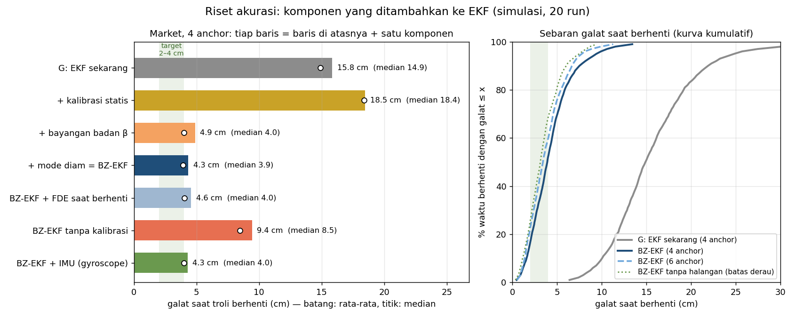
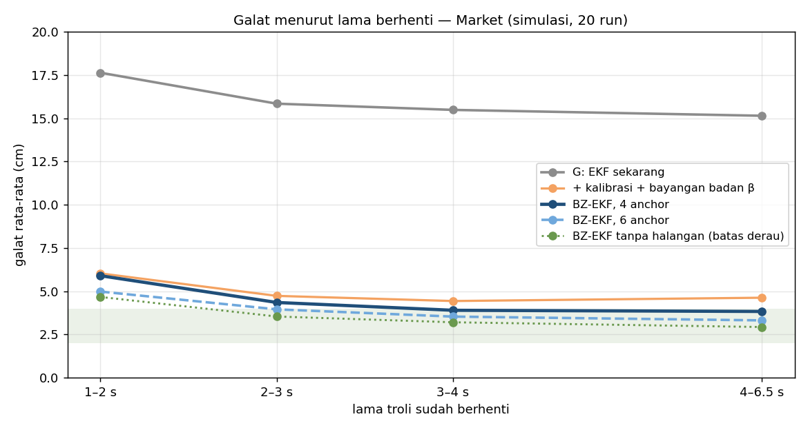
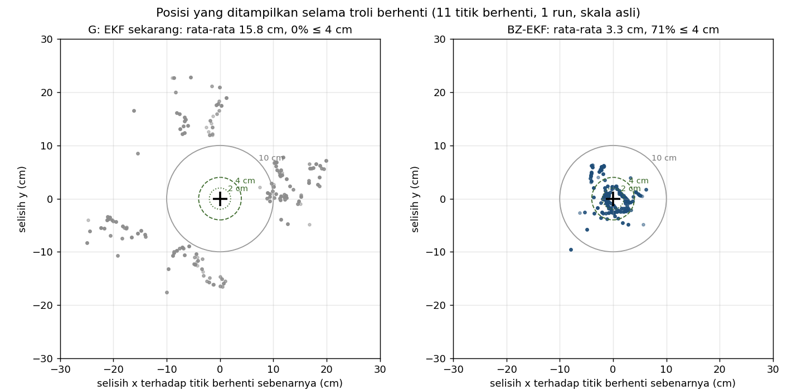
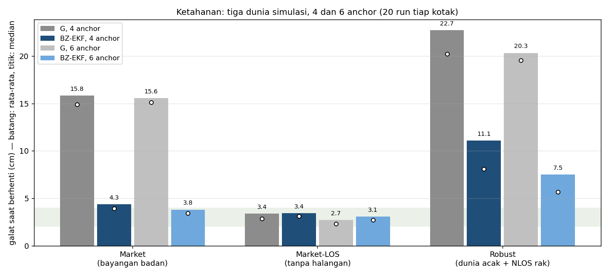
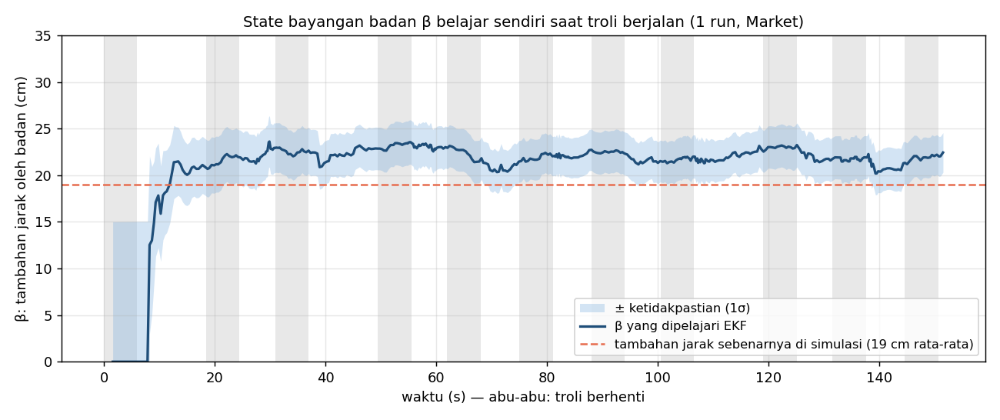
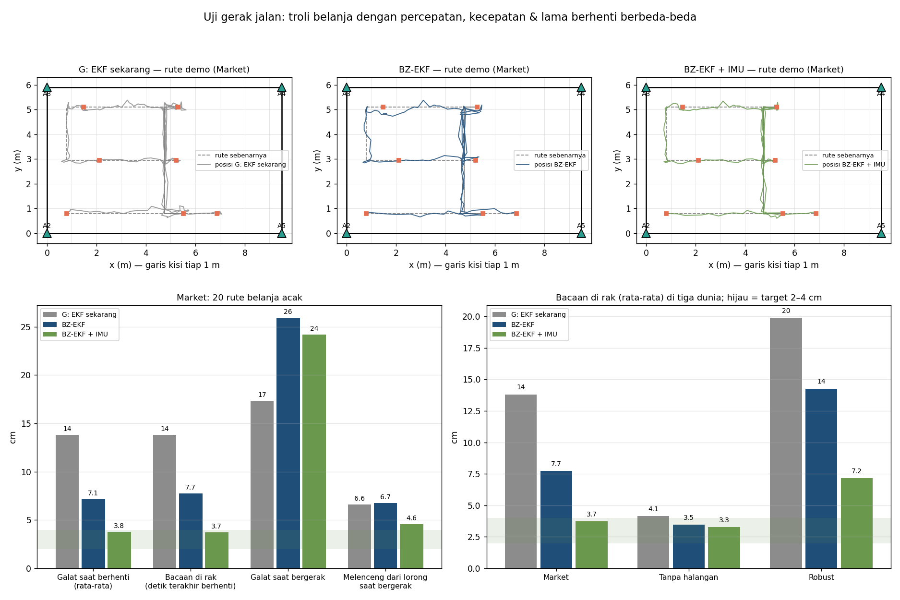
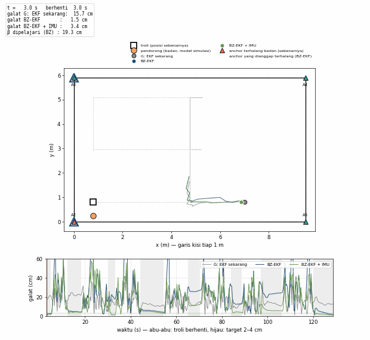

# Riset akurasi: BZ-EKF (hasil simulasi)

> **Catatan (24-10): model dunia di halaman ini TIDAK sesuai sistem sebenarnya.** Di sini
> diasumsikan troli didorong orang yang selalu berada di belakangnya (komponen B, β). Kenyataannya
> troli berjalan sendiri, dan halangan datang dari pembeli lain yang lalu-lalang dari arah mana pun.
> Studi lanjutan untuk dunia yang benar, tanpa hardware tambahan, ada di
> [RISET_JENDELA.md](RISET_JENDELA.md). Dari BZ-EKF hanya komponen **Z (mode diam)** dan
> **kalibrasi statis** yang masih berlaku.

> **Status: hanya simulasi.** Server (`server/tracker.py`) dan firmware **tidak diubah**.
> Semua varian ada di [`tools/accuracy_lab.py`](../../tools/accuracy_lab.py). Gambar dan Excel
> dibuat oleh [`tools/accuracy_report.py`](../../tools/accuracy_report.py).
> Angka di bawah adalah rata-rata **20 simulasi Monte-Carlo** per skenario
> (file [`riset_akurasi.json`](riset_akurasi.json); workbook [`Hasil_Riset_Akurasi.xlsx`](Hasil_Riset_Akurasi.xlsx)).

## Ringkasan

Pertanyaannya: bisakah algoritma berbasis EKF mencapai **2–4 cm** dengan menambahkan
algoritma lain? Jawabannya: bisa **saat troli berhenti**, di skenario Market, **dengan
kalibrasi statis**.

| Galat saat troli berhenti, Market (cm) | Rata-rata | Median | Setelah berhenti ≥ 2 s | P95 | ≤ 4 cm |
|---|---|---|---|---|---|
| G: EKF sekarang (server), 4 anchor | 15,8 | 14,9 | 15,4 | 24,8 | 0 % |
| **BZ-EKF, 4 anchor** | **4,3** | **3,9** | **4,0** | 9,4 | 52 % |
| **BZ-EKF, 6 anchor** | **3,8** | **3,4** | **3,5** | 7,8 | 60 % |
| BZ-EKF tanpa halangan (batas derau model) | 3,4 | 3,1 | 3,1 | 7,5 | 68 % |

- **Tercapai:**
  - Median 3,9 cm dan rata-rata setelah berhenti ≥ 2 s 4,0 cm, keduanya di dalam 2–4 cm.
  - Rata-rata keseluruhan 4,3 cm, sedikit di atas 4 cm. Dengan 6 anchor rata-ratanya 3,8 cm.
  - Hasil ini 3,6× lebih akurat dari G.
  - Hasil ini juga hanya 0,9 cm di atas batas derau. Batas derau adalah galat di ruangan tanpa
    halangan, yang tidak bisa dilampaui dengan derau dan laju data yang sama.
- **Syarat: kalibrasi statis.** Offset tiap anchor diukur sekali dengan tag di titik yang diketahui
  (fitur Kalibrasi di dashboard). Tanpa kalibrasi, hasilnya 9,4 cm.
- **Belum tercapai di dunia "Robust".** Dunia ini menguji ketahanan: bayangan badan acak 8–35 cm
  dan NLOS rak acak. Hasilnya 11,1 cm (4 anchor) dan 7,5 cm (6 anchor). G di dunia yang sama
  22,7 cm dan 20,3 cm.
- **Uji gerak jalan** (20 rute belanja acak dengan percepatan bertahap, kecepatan 0,5–1,0 m/s,
  berhenti 2–12 s; rute ini tidak dipakai saat menyetel parameter):
  - BZ-EKF: median 4,3 cm, rata-rata 7,1 cm.
  - Titik berhenti setelah leg < 1 m setelah belokan meleset 14–18 cm, karena arah hadap tidak
    terlihat dari lintasan sependek itu.
  - Dengan **IMU di tag** (gyroscope + akselerometer): rata-rata 3,8 cm, median 3,2 cm. Target
    tercapai. Lihat [Uji gerak jalan](#uji-gerak-jalan-rute-belanja-acak).
- **Saat bergerak:** galat semua algoritma ±25–30 cm. Penyebabnya keterlambatan data. Pada
  2,5 sampel/anchor/detik dan kecepatan 0,6 m/s, troli sudah maju ±25 cm sebelum data berikutnya
  datang. Target 2–4 cm hanya realistis saat troli berhenti, yaitu saat posisi di depan rak dibaca.



## Kenapa G berhenti di ±15 cm

Saat troli diam, galat G **bukan derau acak, melainkan bias**. Badan orang yang mendorong
berdiri di belakang troli dan menghalangi jalur sinyal ke anchor di belakangnya. Akibatnya jarak
ke anchor itu terbaca 10–35 cm lebih panjang. Literatur menyebut efek ini *human body
shadowing* [1–3].

Merata-rata tidak bisa menghapus bias. Ada masalah tambahan: offset yang dipelajari sendiri oleh
EKF (b dan d) ikut "menelan" sebagian bias badan. Karena itu menambah kalibrasi saja malah
memperburuk hasil (18,5 cm). Bias badan baru hilang setelah ada state yang khusus menjelaskannya.

Di data rekaman asli juga sudah dicek indikator NLOS bawaan DW1000 (`rx_power − fp_power`,
Decawave APS006). Dari 17.650 sampel, median kelebihan jarak hanya naik dari ±2 cm ke ±6 cm
ketika indikatornya tinggi. Hanya nilai > 35 dB yang jelas buruk. Indikator ini terlalu lemah
untuk mengoreksi bias beberapa cm, jadi tidak dipakai.

## Algoritma BZ-EKF

**B**ody-shadow + **Z**ero-velocity EKF: EKF yang sudah ada (G), ditambah empat komponen.

| | Komponen | Apa yang dilakukan | Referensi |
|---|---|---|---|
| K + F | **Kalibrasi statis, dipercaya** | Offset jarak tiap anchor diukur sekali (galat ±2 cm), lalu tidak dipelajari ulang oleh EKF. Tujuannya agar offset tidak menelan bias badan. | — |
| B | **State bayangan badan β** | Satu state baru di EKF: tambahan jarak pada anchor yang ada di belakang arah jalan troli. | [1], [2] |
| hd | **Arah hadap dari lintasan** | Arah jalan = garis lurus terbaik (PCA) melalui posisi 4 s terakhir saat bergerak, minimal 1 m. Dibekukan saat troli berhenti. | — |
| Z | **Mode diam (ZUPT)** | Kecepatan < 0,2 m/s selama 0,4 s → kecepatan dikunci 0 dan derau proses dikecilkan. Mode ini dilepas bila 3 dari 4 inovasi terakhir > 1,5σ. | [4], [5] |

**Model pengukuran.** Untuk anchor *i*, jarak yang diharapkan EKF adalah:

```
jarak_i = ‖posisi − anchor_i‖ + b + d_i + s_i · β
s_i = 0 … 1  : seberapa "di belakang" anchor i terhadap arah jalan
              (0 bila cos sudut > −0,2;  1 bila cos sudut < −0,5)
```

- **Variabel yang diestimasi EKF:** posisi (x, y), kecepatan, offset b dan d_i (dari kalibrasi),
  dan **β**.
- **Kenapa β bisa dibedakan dari offset:** anchor yang berada di belakang selalu berganti setiap
  kali troli berbelok. Karena itu β bisa belajar sendiri selama troli berjalan (gambar 5).

**Kenapa arah hadap tidak diambil dari kecepatan EKF.**

- Kecepatan EKF berbelok saat troli mengerem. Ia juga berbelok saat ada outlier; di satu kasus
  dua outlier 1,2 m datang sekaligus.
- Arah yang salah membuat anchor yang salah ditandai "terhalang", dan galatnya naik sampai 20 cm.
- Garis lurus melalui ±10 posisi jauh lebih stabil. Galat sudutnya ±6°, dibanding ±30° bila
  dihitung dari dua titik.

**Kenapa perlu mode diam.**

- Dengan σa = 0,8 m/s², ketidakpastian posisi EKF saat diam masih ±15 cm. Akibatnya satu putaran
  jarak yang buruk masih lolos gerbang dan menggeser posisi 20–45 cm.
- Mode diam adalah ZUPT, yang biasa dipakai pada sensor inersia di sepatu [4], dalam bentuk
  pergantian model diam/bergerak ala IMM [5].
- Dengan mode diam, posisi saat berhenti tetap di tempat. Data yang buruk ditolak oleh gerbang.





## Hasil lengkap (4 anchor, cm)

| Algoritma | Market rata-rata | Market median | Market-LOS | Robust rata-rata | Robust median | Galat bergerak (Market) |
|---|---|---|---|---|---|---|
| G: EKF sekarang | 15,8 | 14,9 | 3,4 | 22,7 | 20,2 | 18,1* |
| + kalibrasi statis (K+F) | 18,5 | 18,4 | 3,4 | 27,7 | 24,8 | 21,0 |
| + bayangan badan β + arah hadap | 4,9 | 4,0 | 3,4 | 12,7 | 9,2 | 27,3 |
| **+ mode diam = BZ-EKF** | **4,3** | **3,9** | **3,4** | **11,1** | **8,1** | 28,0 |
| BZ-EKF + hitung ulang saat berhenti + FDE | 4,6 | 4,0 | 3,8 | 11,2 | 7,6 | 28,0 |
| BZ-EKF tanpa kalibrasi statis | 9,4 | 8,5 | 3,5 | 16,8 | 14,3 | 22,9 |
| BZ-EKF + IMU di tag (opsi perangkat keras) | 4,3 | 4,0 | 3,2 | 10,4 | 8,4 | 27,5 |

\* **Galat bergerak G terlihat lebih kecil hanya kebetulan.** Bias badan mendorong posisi ke depan
dan menutupi keterlambatan. Di Market-LOS (tanpa badan), galat bergerak G 26,3 cm dan BZ-EKF
29,6 cm. Mode diam menambah ±3 cm keterlambatan saat troli mulai berjalan lagi.





## Yang dicoba tetapi tidak dipakai

| Ide | Hasil (Market, 4 anchor) | Kenapa tidak dipakai |
|---|---|---|
| Hitung ulang dari median jarak saat berhenti (S) | 15,4 cm, dicoba tanpa β | Bias badan tetap ada di median |
| FDE / RAIM: buang anchor yang janggal [6] | 15,3 cm tanpa β; 4,6 cm dengan BZ-EKF | Dengan 4 anchor hanya ada 2 persamaan cadangan; tidak menambah akurasi |
| *Residual weighting* [7] | 15,2 cm | Sama seperti FDE |
| Bobot kecil untuk anchor di belakang | 16,1 cm | Anchor di belakang tetap memberi informasi; β lebih tepat |
| Huber simetris (β menjelaskan jarak panjang) | lebih buruk | Outlier 0,3–1,5 m jadi lebih berpengaruh |
| Jendela rata-rata lebih panjang saat berhenti | sama | Bias tidak hilang dengan dirata-rata |
| Indikator NLOS DW1000 (rx − fp) | — | Di data asli terlalu lemah, lihat di atas |
| Uji arah hadap saat berhenti: dari 24 arah, pilih yang pola terhalangnya paling cocok | rute belanja 7,5 → 9,3 cm | Dengan 2 persamaan cadangan, arah yang salah sering sama cocoknya |
| Arah hadap dua skala (0,4 m setelah belokan) | rute belanja 7,5 → 6,0 cm; rute persegi 4,4 → 5,0 cm | Hanya memindahkan galat; disetel pada data uji = curang |

## Uji gerak jalan (rute belanja acak)

Parameter BZ-EKF disetel pada satu rute persegi dengan kecepatan tetap 0,6 m/s dan berhenti 6 s.
Untuk menguji apakah hasilnya berlaku umum, [`tools/walk_test.py`](../../tools/walk_test.py)
membuat **20 rute belanja acak per dunia** di ruangan yang sama:

- lewat lorong (y = 0,8 / 2,95 / 5,1 m; lorong silang x = 0,8 / 4,75 / 8,7 m);
- percepatan dan pengereman bertahap 0,5 m/s²;
- kecepatan tiap leg 0,5–1,0 m/s;
- berhenti 2–12 s di rak acak.

Rata-rata satu rute: 43 m, 149 s, 8,8 titik berhenti.

| Market (cm) | Rata-rata diam | Median diam | **Bacaan di rak** | Rak ≤ 4 cm | P95 rak | Galat bergerak | Melenceng dari lorong |
|---|---|---|---|---|---|---|---|
| G: EKF sekarang | 13,8 | 12,9 | 13,8 | 1 % | 26,5 | 17,3 | 6,6 |
| BZ-EKF | 7,1 | 4,3 | 7,7 | 46 % | 22,8 | 25,9 | 6,7 |
| **BZ-EKF + IMU** | **3,8** | **3,2** | **3,7** | **63 %** | **7,4** | 24,2 | 4,6 |

| Bacaan di rak (cm) | Market | Tanpa halangan | Robust |
|---|---|---|---|
| G: EKF sekarang | 13,8 | 4,1 | 19,9 |
| BZ-EKF | 7,7 | 3,5 | 14,3 |
| BZ-EKF + IMU | 3,7 | 3,3 | 7,2 |

- **Arti kolom:**
  - *Bacaan di rak* = rata-rata posisi pada detik terakhir setiap berhenti, yaitu posisi yang
    dipakai untuk tahu troli ada di depan rak mana.
  - *Melenceng dari lorong* = jarak posisi ke garis rute saat bergerak. Angka ini menunjukkan
    apakah troli digambar di lorong yang benar, walaupun posisinya tertinggal.
- **Kenapa BZ-EKF jatuh dari 4,3 ke 7,1 cm di rute belanja:**
  - Berhenti setelah leg ≥ 1 m: galatnya 3,3–3,6 cm, sama seperti di rute persegi.
  - Berhenti setelah leg < 1 m sesudah belokan: galatnya 14–18 cm. Arah hadap masih arah lorong
    sebelumnya (meleset ±85°), sehingga anchor yang salah dianggap terhalang.
- **IMU menyelesaikan dua masalah:**
  - Gyroscope memberi arah hadap langsung, termasuk di leg pendek.
  - Akselerometer merasakan dorongan pertama, jadi mode diam dilepas seketika. Tanpa IMU, mode
    diam baru dilepas ±1 s setelah troli mulai jalan, dan galat sempat melonjak 50–60 cm (terlihat
    di grafik bawah animasi).
- **Model IMU di simulasi:** arah hadap asli + galat tetap ±5° + acak ±3°; dorongan terasa
  setelah 0,1 s. Contoh sensor yang cocok: MPU6050 atau BNO055 lewat I²C ke ESP32 tag.



**Animasi:** [`uji_jalan_animasi.gif`](uji_jalan_animasi.gif), atau
[`uji_jalan_animasi.mp4`](uji_jalan_animasi.mp4) untuk presentasi. Kecepatannya 3× waktu nyata,
satu rute demo. Isinya:

- kotak = troli asli; bulatan oranye = pendorong;
- abu-abu = G; biru = BZ-EKF; hijau = BZ-EKF + IMU;
- anchor oranye = terhalang badan sebenarnya; cincin biru = anchor yang dianggap terhalang oleh
  BZ-EKF;
- grafik bawah = galat ketiganya dari waktu ke waktu.



## Batasan (penting dibaca)

1. **Simulasi, belum diuji di ruangan.** Model badan disederhanakan: tambahan +15 cm untuk anchor
   di belakang (cos sudut < −0,35). Dunia "Robust" sengaja mengacak model ini, dan di sana target
   belum tercapai.
2. **Butuh kalibrasi statis yang baik** (galat ≤ ±2 cm per anchor). Galat koordinat anchor juga
   ikut. Pada rekaman 23-10, offset per anchor ±22–30 cm, yang menandakan koordinat anchor atau
   ukuran ruangan yang dimasukkan masih salah. Itu harus dibereskan dulu.
3. **Arah hadap diambil dari lintasan UWB.** Akibatnya:
   - saat pertama menyala, sebelum troli pernah berjalan, β belum bisa dipakai;
   - setelah belokan dengan leg < 1 m, arahnya masih salah (lihat uji gerak jalan).

   IMU di tag (gyroscope) memberi arah langsung, seperti pada [1] dan [2]. Di simulasi, IMU
   menurunkan bacaan di rak dari 7,7 ke 3,7 cm.
4. **Saat bergerak** akurasi tetap ±25–30 cm karena keterlambatan data. Yang bisa memperbaiki:
   laju ranging lebih tinggi, atau fusi akselerometer IMU (belum diuji).
5. **Belum dipasang ke server.** Kalau mau diterapkan, langkahnya:
   - `BodyFilter` dan mode diam dipindah dari `tools/accuracy_lab.py` ke `server/tracker.py`
     sebagai opsi;
   - lakukan kalibrasi statis;
   - uji dengan rekaman di ruanganmu.

## Cara menjalankan ulang

```bash
python tools/accuracy_lab.py            # ±1–2 menit: angka -> docs/hasil-simulasi/riset_akurasi.json
python tools/walk_test.py               # ±4 menit: uji gerak jalan + animasi (uji_jalan_*)
python tools/accuracy_report.py         # gambar riset_*.png + Hasil_Riset_Akurasi.xlsx
```

## Istilah

- **Galat saat berhenti:** jarak antara posisi yang ditampilkan dan posisi sebenarnya. Diambil
  tiap 100 ms, mulai 1 s setelah troli berhenti.
- **Rata-rata / median / P95:**
  - median = 50% galat ada di bawahnya;
  - P95 = 95% galat ada di bawahnya.
- **β (beta):** tambahan jarak oleh badan pendorong, dipelajari sendiri oleh EKF.
- **ZUPT:** *zero-velocity update*. Saat diam, EKF menganggap kecepatan 0.
- **FDE:** *fault detection & exclusion*. Membuang anchor yang jaraknya tidak cocok dengan anchor
  lain.
- **Inovasi (ν):** selisih jarak terukur dan jarak yang diharapkan EKF, dibagi ketidakpastiannya.
- **Batas derau:** galat di ruangan tanpa halangan dengan derau dan laju data yang sama.
- **NLOS rak:** episode acak (10% waktu) ketika sebuah anchor terhalang rak, sehingga jaraknya
  bertambah 15–60 cm selama ±3 s.

## Referensi

1. De Cock, C. dkk. (2023). *Robust IMU-Based Mitigation of Human Body Shadowing in UWB Indoor
   Positioning.* Sensors. — model galat jarak dipilih menurut orientasi badan–tag–anchor.
2. Tian, Q. dkk. (2019). *Human Body Shadowing Effect on UWB-Based Ranging System for Pedestrian
   Tracking.* IEEE Trans. Instrum. Meas. — galat jarak menurut derajat halangan badan + arah dari
   gyroscope.
3. Naheem, K. dkk. (2024). *A Robust Indoor Pedestrian Localization Approach Against Human Body
   Shadowing for UWB-Enabled Smartphones.* IEEE Trans. Instrum. Meas.
4. Foxlin, E. (2005). *Pedestrian tracking with shoe-mounted inertial sensors.* IEEE Computer
   Graphics and Applications 25(6), 38–46. — ZUPT.
5. Blom, H. A. P. & Bar-Shalom, Y. (1988). *The interacting multiple model algorithm for systems
   with Markovian switching coefficients.* IEEE Trans. Automatic Control 33(8), 780–783.
6. Parkinson, B. W. & Axelrad, P. (1988). *Autonomous GPS integrity monitoring using the
   pseudorange residual.* Navigation 35(2). — RAIM/FDE.
7. Chen, P.-C. (1999). *A non-line-of-sight error mitigation algorithm in location estimation.*
   IEEE WCNC.
8. Decawave (Qorvo). *APS006 Part 3: DW1000 Diagnostics for NLOS Channels.*
