# Studi jendela: semua kombinasi G × C × mode diam (hasil simulasi)

> **Status: hanya simulasi, tanpa hardware tambahan.** Server dan firmware **tidak diubah**.
> Skrip: [`tools/window_study.py`](../../tools/window_study.py) menghitung angka dan menulis
> [`jendela.json`](jendela.json). [`tools/window_report.py`](../../tools/window_report.py) membuat
> gambar, animasi, dan [`Hasil_Jendela.xlsx`](Hasil_Jendela.xlsx).
> Total: **5.539 kombinasi × 3 dunia × 20 rute acak**.
>
> **Tanpa hardware tambahan:** semua yang direkomendasikan di sini hanya perangkat lunak (Z, L)
> dan satu prosedur (K, kalibrasi lewat dashboard) dengan 4 anchor + 1 tag yang sudah ada. IMU
> dan anchor tambahan dari [RISET_AKURASI.md](RISET_AKURASI.md) **tidak dipakai**.

## Ringkasan

- **Kombinasi terbaik tanpa hardware tambahan: K+G+Z+L, tanpa jendela tambahan.** Isinya:
  - G = EKF server sekarang: gerbang validitas, offset per anchor, bobot jarak panjang;
  - K = kalibrasi statis offset anchor, prosedur lewat dashboard, bukan hardware;
  - Z = mode diam;
  - L = saat diam, jarak yang kepanjangan ditolak.

  | Bacaan di rak (cm) | Kosong (0 pembeli) | Sepi (2) | Ramai (5) | Rata-rata | Galat bergerak |
  |---|---|---|---|---|---|
  | G (server sekarang) | 4,4 | 6,7 | 10,0 | 7,0 | 21,8 |
  | **K+G+Z+L** | **3,0** | **3,4** | 5,4 | **3,9** | 23,2 |
  | G+Z+L (tanpa kalibrasi) | 3,5 | 4,6 | 7,4 | 5,2 | 23,9 |
  | C (jendela 20 × 20) | 61,6 | 63,4 | 65,2 | 63,4 | 176,8 |
  | G + jendela C | 61,7 | 62,5 | 64,7 | 63,0 | 176,7 |

- **Target 2–4 cm:**
  - Tercapai di toko kosong (3,0 cm) dan sepi (3,4 cm), dan rata-rata ketiga dunia 3,9 cm.
  - Belum tercapai saat ramai (5,4 cm). Pada titik berhenti di mana 1 anchor terhalang lebih dari
    separuh waktu berhenti, galatnya 5–6,5 cm. Kalau 2 anchor terhalang, ±11 cm. Tanpa anchor
    tambahan, itu batas geometri.
- **G + jendela C ternyata gagal (63 cm).** Garisnya memang paling mulus: kegoyahan 0,6 cm,
  dibanding 15 cm pada G. Tapi posisinya terlambat ±15 detik, jadi "stabil tapi salah". Rinciannya
  ada di [bagian ini](#kenapa-g--jendela-c-gagal).
- **BZ-EKF digabung juga.**
  - **Z (mode diam)** dipakai di rekomendasi.
  - **B (bayangan badan di belakang arah jalan)** diuji pada semua jendela, tapi selalu
    memperburuk hasil. Di toko ini troli berjalan sendiri dan badan pembeli datang dari arah mana
    saja. Lihat [BZ-EKF di dunia troli robot](#bz-ekf-di-dunia-troli-robot).
  - Pengganti B yang cocok adalah **L**: menolak jarak kepanjangan saat diam, tanpa menganggap
    arahnya.
- **Uji tanpa pejalan kaki** = dunia **Kosong**: 3,0 cm. Ada juga animasinya sendiri,
  [`jendela_animasi_kosong.gif`](jendela_animasi_kosong.gif).

## Konsep jendela 20

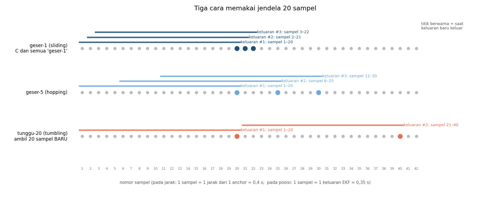

| Cara | Sampel yang diambil | Keluaran baru | Di studi |
|---|---|---|---|
| **geser-1** (sliding) | 1–20, lalu 2–21, 3–22, … | setiap sampel | **ini yang dipakai C** |
| geser-5 (hopping) | 1–20, lalu 6–25, 11–30, … | tiap 5 sampel | diuji |
| tunggu-20 (tumbling) | 1–20, lalu 21–40, … (menunggu 20 sampel **baru**) | tiap 20 sampel, ditahan di antaranya | diuji |
| adaptif-diam (G) | keluaran sejak troli berhenti, maks. N; saat bergerak tanpa jendela | setiap sampel | diuji |

**"20" itu berapa detik, tergantung di mana jendelanya dipasang:**

- **Pada jarak** (sebelum EKF): 1 sampel = 1 jarak dari 1 anchor, 2,5 per detik.
  - 20 sampel = **8 detik**.
  - Rata-rata geser-1 terlambat (20−1)/2 sampel = **3,8 s**, atau 1,9 m kalau troli jalan 0,5 m/s.
- **Pada posisi** (sesudah EKF): 1 sampel = 1 keluaran EKF, ±2,9 per detik.
  - 20 sampel ≈ **7 detik**, terlambat ±3,3 s.
- **tunggu-20:**
  - pada jarak, keluarannya hanya tiap 8 s per anchor. Gerbang validitas lalu menganggap posisi
    tidak valid (ketersediaan 3%);
  - pada posisi, posisinya melompat tiap ±7 s.

Semua kombinasi ukuran (3, 5, 10, 20) × cara (geser-1, geser-5, tunggu-N, adaptif) × statistik
(rata-rata, median) × tempat (jarak, posisi, keduanya) sudah dicoba. Hasilnya ada di peta panas di
bawah: **hanya jendela pendek (≤ 5) yang tidak merusak**.

## Dunia simulasi (sesuai sistem sebenarnya)

- **Troli robot** berjalan sendiri lewat lorong:
  - kecepatan 0,3–0,7 m/s, percepatan 0,3 m/s²;
  - berhenti 3–12 s di 8 rak acak;
  - rata-rata satu rute 191 s (142–216 s), dengan 8,8 kali berhenti.
- **Tidak ada pendorong.** Halangan datang dari **pembeli** yang berjalan (0,8–1,3 m/s) dan
  berhenti melihat rak (0,5–8 s), dari arah mana pun:
  - tubuh pembeli dimodelkan sebagai silinder lebar 0,44 m, tinggi 1,70 m;
  - kalau berdiri di garis tag–anchor, jarak anchor itu bertambah 10–30 cm.
- **Tiga dunia:**
  - **Kosong** (tidak ada pembeli: uji tanpa pedestrian);
  - **Sepi** (2 pembeli);
  - **Ramai** (5 pembeli di ruangan 9,5 × 5,9 m).
- Model radio lain sama dengan simulasi sebelumnya:
  - derau 6 cm, outlier 4%, paket hilang 8%;
  - 4 anchor di sudut, tag di ketinggian 1,0 m;
  - kalibrasi statis dengan galat 2 cm per anchor.

## Yang dikombinasikan

| Sumbu | Pilihan |
|---|---|
| Inti EKF | EKF lama (dasar A dan C), G, G+Z, K+G+Z, G+Z+L, K+G+Z+L, K+B+Z (BZ-EKF), K+B+Z+L, K+R+Z, K+R+Z+L |
| Jendela pada jarak (sebelum EKF) | tanpa; geser-1 rata/median 3·5·10·20; geser-5 rata/median 10·20; tunggu-5·10·20 rata/median |
| Keluaran | EKF; hitung ulang dari median jarak saat berhenti (S); S + buang anchor janggal (S+FDE) |
| Jendela pada posisi (sesudah EKF) | tanpa; geser-1 3·5·10·20; geser-5 10·20; tunggu-5·10·20; adaptif-diam 5·10·20·50·100 (semua rata/median) |

**Komponen baru L:** saat troli diam, sebuah jarak yang **lebih panjang** dari perkiraan EKF
lebih dari 1σ **ditolak**, bukan hanya dikurangi bobotnya.

- **Alasannya:** tubuh orang hanya bisa **memperpanjang** jarak, tidak pernah memendekkan. Ini ide
  "bayangan badan" yang sama, tapi tanpa anggapan badannya selalu di belakang.
- **Jarak yang lebih pendek tetap diterima.**
- **Mode diam tetap tahu kapan troli jalan lagi**, karena keputusan itu diambil sebelum
  penolakan.

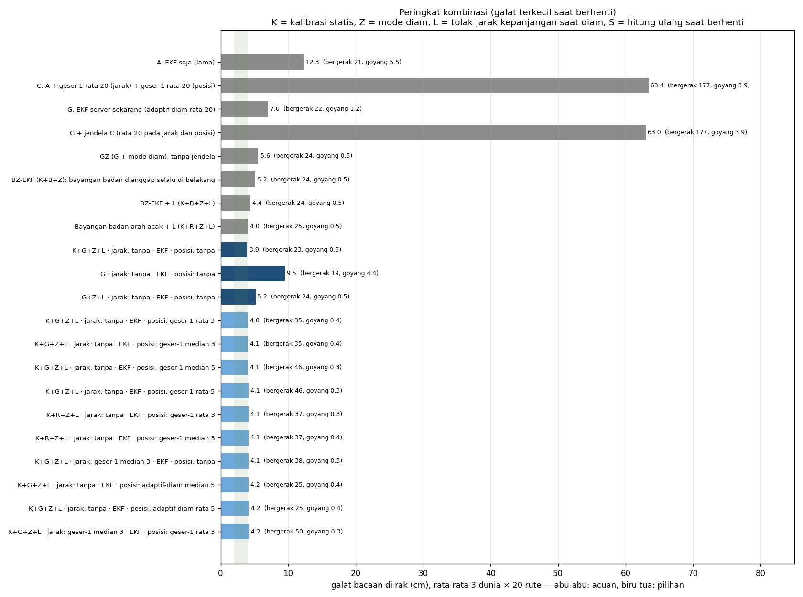

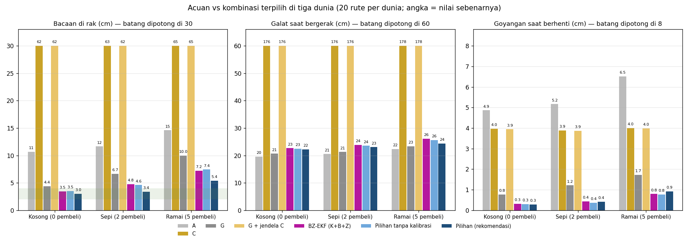

### Semua kombinasi jendela pada inti terbaik

Baris = jendela pada jarak, kolom = jendela pada posisi, angka = cm (rata-rata 20 rute).

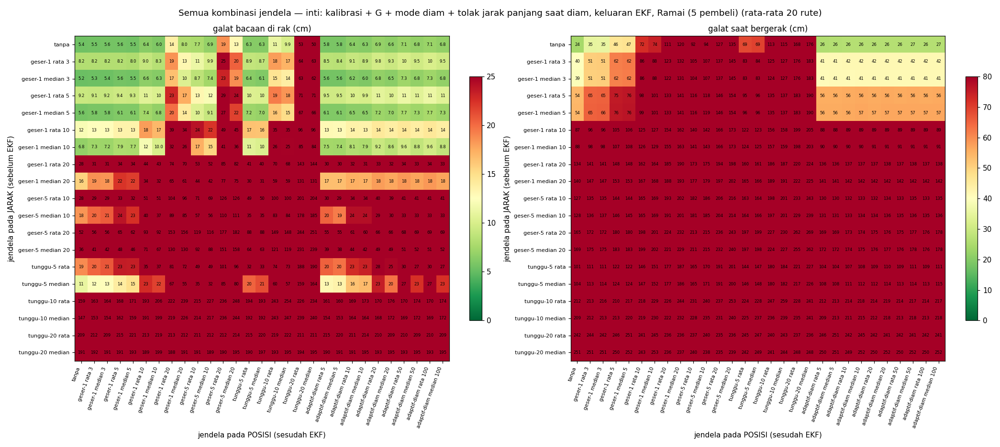

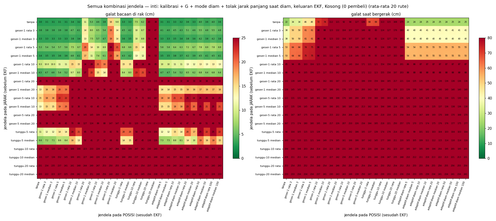

Peta yang sama untuk inti G (server sekarang): [`jendela_1_peta_G.png`](jendela_1_peta_G.png).

## BZ-EKF di dunia troli robot

BZ-EKF dari [RISET_AKURASI.md](RISET_AKURASI.md) punya dua bagian:

- **B:** state β untuk bayangan badan di anchor yang berada di **belakang arah jalan**;
- **Z:** mode diam.

Untuk toko dengan troli robot dibuat juga **R: bayangan badan dari arah mana saja**.

- Setiap anchor punya state ρᵢ ≥ 0: tambahan jarak oleh badan yang sedang berdiri di antara tag
  dan anchor itu.
- ρᵢ memudar kembali ke 0 (τ 3 s) kalau jarak tidak lagi memintanya, karena pembeli berjalan
  lagi.
- R tidak menebak arah badannya (`RandBodyFilter` di `tools/accuracy_lab.py`).

B dan R diuji bersama Z, L, dan **semua jendela**, termasuk rata 3 yang dipakai di web.

| Bacaan di rak (cm) | Kosong | Sepi | Ramai | Rata-rata | Bergerak |
|---|---|---|---|---|---|
| K+G+Z (tanpa B/R) | 3,0 | 4,1 | 6,2 | 4,4 | 23,1 |
| K+B+Z (**BZ-EKF**) | 3,5 | 4,8 | 7,2 | 5,2 | 24,2 |
| K+B+Z+L | 3,3 | 3,8 | 6,1 | 4,4 | 23,9 |
| K+B+Z+L + rata 3 | 3,3 | 3,9 | 6,3 | 4,5 | 35,3 |
| K+R+Z (bayangan badan arah acak) | 3,1 | 4,3 | 6,2 | 4,5 | 25,8 |
| K+R+Z+L | 3,1 | 3,8 | **5,2** | 4,0 | 25,3 |
| K+R+Z+L + rata 3 | 3,2 | 3,9 | 5,3 | 4,1 | 36,6 |
| **K+G+Z+L (rekomendasi)** | **3,0** | **3,4** | 5,4 | **3,9** | **23,2** |
| K+G+Z+L + rata 3 (web + kalibrasi) | 3,1 | 3,5 | 5,5 | 4,0 | 34,5 |

- **B selalu memperburuk**, dengan atau tanpa L dan dengan jendela apa pun.
  - Kombinasi B terbaik adalah K+B+Z+L tanpa jendela (4,4 cm).
  - Penyebabnya, B menganggap badan selalu di belakang troli, padahal di toko ini pembeli
    menghalangi dari arah mana saja. Akibatnya β mengoreksi anchor yang sebenarnya tidak
    terhalang.
- **R + L hampir menyamai rekomendasi** (4,0 vs 3,9 cm).
  - Saat ramai sedikit lebih baik (5,2 vs 5,4 cm), tapi saat sepi lebih buruk (3,8 vs 3,4 cm).
  - Galat saat bergerak +2 cm, dan R butuh 4 state tambahan (EKF 13 state, ±2× lebih berat).
  - Jadi R tidak dipakai. Kalau toko nanti benar-benar selalu ramai, R + L layak dicoba lagi.
- **Yang dipakai: Z + L.** L memakai sifat yang sama ("badan hanya memperpanjang jarak") tanpa
  menebak arah dan tanpa state tambahan.

## Kenapa G + jendela C gagal

- **Troli berhenti 3–12 s, tapi C butuh ±15 s untuk "sampai".** Jendela 20 pada jarak terlambat
  3,8 s, dan jendela 20 pada posisi menambah ±3,3 s. Posisi baru benar-benar menetap setelah kedua
  jendela terisi data dari titik berhenti: 8 s + 7 s. Sebelum itu troli sudah jalan lagi. Bacaan di
  rak meleset 62–65 cm, dan saat bergerak posisinya tertinggal 1,8 m.
- **Mode diam (Z) memberi kestabilan C tanpa terlambat.**
  - Goyangan saat diam turun dari 1,2 cm (G) ke 0,3–0,9 cm.
  - Saat bergerak, Z tidak menahan apa-apa.
  - Kestabilan yang dicari dari C ada di sini.
- **Kalau garis saat bergerak mau dibuat lebih mulus**, jendela posisi **geser-1 rata 3** masih
  layak:
  - kegoyahan garis turun dari ±14,5 ke ±5,6 cm;
  - bacaan di rak tetap 4,0 cm;
  - tapi galat bergerak naik ke 34,5 cm karena lag ±0,35 s plus sudut belokan yang terpotong.

  Pakai hanya kalau tampilan yang mulus lebih penting.

## Yang dicoba tetapi tidak dipakai

| Ide | Hasil (bacaan di rak, kosong / sepi / ramai) | Kenapa tidak |
|---|---|---|
| Kuartil bawah (25%) jarak saat berhenti, bukan median, + FDE | 3,5 / 4,2 / 5,1 cm (12 rute) | Ramai sedikit lebih baik, kosong lebih buruk; L lebih sederhana dan lebih baik |
| Membuka ulang ketidakpastian posisi saat mulai diam | ramai 4,8 → 4,7 cm | Hampir tidak berpengaruh |
| Hitung ulang saat berhenti (S, S+FDE) di atas K+G+Z+L | S 3,4 / 4,6 / 7,6 cm; S+FDE 3,4 / 4,2 / 6,9 cm (vs 3,0 / 3,4 / 5,4) | EKF dengan mode diam + L sudah merata-rata dengan benar |
| Jendela adaptif-diam (cara G) di atas mode diam | sedikit lebih buruk | Ikut merata-ratakan detik pertama berhenti yang belum menetap |
| Ambang L lebih ketat (0,7σ) | lebih buruk | Jarak LOS dengan derau positif ikut terbuang, hasilnya bias pendek |

## Batasan

1. **Simulasi.** Besar tambahan jarak oleh tubuh (10–30 cm) dan lebar tubuh adalah asumsi. Perlu
   diukur di ruangan: tag diam, lalu seseorang berdiri di antara tag dan anchor.
2. **Ramai belum ≤ 4 cm.** Dengan 4 anchor, kalau 2 terhalang lama, hanya tersisa 2 persamaan untuk
   2 koordinat, tanpa cadangan.
3. **Kalibrasi statis harus baik**, dengan galat ±2 cm per anchor. Tanpa K, hasilnya 5,2 cm rata-rata.
4. **Saat bergerak**, galat semua kombinasi yang wajar tetap ±22–24 cm, karena data datang
   2,5×/detik per anchor. Target 2–4 cm hanya realistis saat troli berhenti.
5. **Rekaman asli tidak punya ground truth.** Lihat bagian
   [Algoritma di server](#algoritma-di-server). Akurasi di ruangan baru bisa diukur
   dengan titik yang diukur meteran laser: Setup → Calibration & static test, centang "keep" dimatikan.

## Algoritma di server

Server sekarang **hanya** menjalankan algoritma rekomendasi **K + G + Z + L**
(`server/tracker.py`). Varian lain di studi ini (C, B, R, jendela pada jarak, dan seterusnya)
dipindah ke `tools/tracker_lab.py`, yang hanya dipakai skrip di `tools/`.

- **Nilainya tetap**, tidak ada lagi kolom parameter di Setup → Tracker. Yang bisa diubah hanya
  centang **"Smooth the path"** (rata-rata 3 posisi terakhir, default dicentang).
- **K otomatis:** begitu setiap anchor punya titik kalibrasi, offset diambil dari kalibrasi.
  Sebelum itu offset dipelajari sendiri (G + Z + L).
- **Hasil dicek sama dengan lab:** pada data simulasi yang sama, versi server menghasilkan angka
  identik dengan versi lab, dengan maupun tanpa kalibrasi dan haluskan jalur.
- **Pengaman tambahan:** L hanya membuang jarak selama anchor lain masih cukup untuk menghitung
  posisi. Di rekaman asli tanpa pengaman ini, ketersediaan posisi turun ke 78% (test-2), karena
  koordinat anchor yang salah membuat satu anchor terus terbaca kepanjangan.

### Uji pada rekaman asli 23-10

Keempat rekaman 23-10 diputar ulang lewat tracker server dengan setiap algoritma
([`tools/replay_compare.py`](../../tools/replay_compare.py); gambar dan
[`Replay_Rekaman.xlsx`](../laporan-akurasi/Replay_Rekaman.xlsx) di
[`docs/laporan-akurasi/`](../laporan-akurasi/)).

**Rekaman ini tidak punya ground truth**, karena tidak ada titik yang diukur. Yang dibandingkan
hanya:

- kestabilan saat diam: CEP. Status diam dicari dari jarak mentah, sama untuk semua algoritma;
- kegoyahan garis saat bergerak;
- posisi di luar ruangan;
- ketersediaan.

| Rata-rata 4 rekaman | Diam CEP50 | Diam CEP95 | Kegoyahan garis | Di luar ruangan | Valid |
|---|---|---|---|---|---|
| A. EKF saja (lama) | 10,9 cm | 19,4 cm | 30,6 cm | 1% | 100% |
| C. jendela 20 × 20 | 3,6 cm | 8,8 cm | 8,6 cm | 0% | 100% |
| G. server lama | 2,2 cm | 4,4 cm | 21,3 cm | 0% | 98% |
| G + jendela C | 2,1 cm | 4,8 cm | 9,5 cm | 1% | 98% |
| G + mode diam (Z) | 0,6 cm | 1,4 cm | 14,5 cm | 0% | 98% |
| G + Z + L | 0,8 cm | 1,7 cm | 13,7 cm | 0% | 98% |
| **G + Z + L + rata 3 (di web)** | **0,8 cm** | **1,4 cm** | **6,1 cm** | **0%** | **98%** |

- **Algoritma web paling stabil sekaligus paling mulus.** Sebaran saat diam 3× lebih kecil dari G,
  dan garisnya lebih mulus dari C. Di gambar lintasan ia tetap mengikuti putaran keliling ruangan,
  sedangkan C memotong sudut.
- **Ini kestabilan, bukan akurasi.** Akurasi ke posisi sebenarnya tidak bisa diketahui dari
  rekaman ini.
- **Koordinat anchor perlu diukur ulang.** Dashboard memberi peringatan "check position" untuk
  anchor-4 (+21 cm) dan anchor-5 (−18 cm). Kolom "konsistensi jarak" di Excel juga ±25 cm untuk
  semua algoritma.

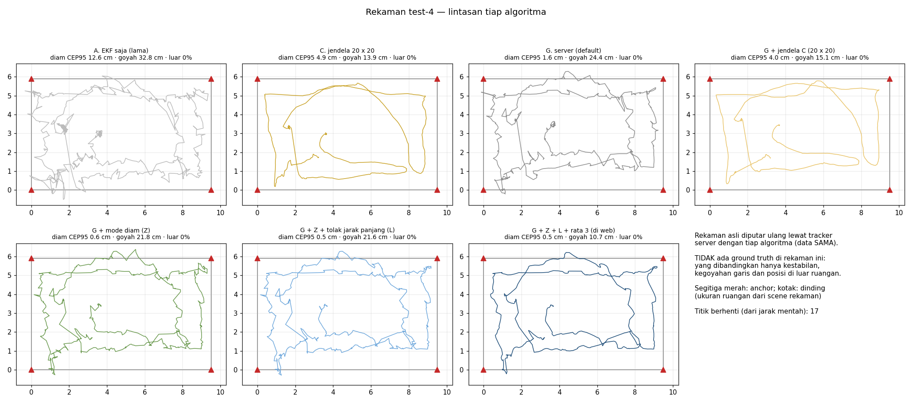

### Video uji jalan dengan algoritma di web

[`web_uji_jalan_ramai.gif`](web_uji_jalan_ramai.gif) dan
[`web_uji_jalan_kosong.gif`](web_uji_jalan_kosong.gif) (MP4 dengan nama yang sama) memperlihatkan
troli robot berjalan di simulasi dengan tiga versi, semuanya dijalankan oleh **kode server**:

- G (algoritma server lama);
- algoritma server sekarang, haluskan jalur dicentang, tanpa kalibrasi;
- algoritma yang sama dengan kalibrasi.

Gambar lintasannya: [`web_uji_jalan_lintasan.png`](web_uji_jalan_lintasan.png).

### Langkah uji di ruanganmu (ground truth asli)

Rekaman yang ada belum punya posisi terukur, jadi akurasi asli (2–4 cm atau tidak) hanya bisa
dibuktikan di ruanganmu:

1. **Ukur ulang koordinat anchor** dengan meteran laser, terutama anchor-4 dan anchor-5. Keduanya
   diberi peringatan "check position" di dashboard (offset +21 / −18 cm). Ubah lewat
   Live → Inspector (klik anchor-nya).
2. **Kalibrasi statis.** Taruh tag diam di 2–4 titik yang kamu ukur, **bukan** di posisi anchor.
   - Isi X/Y di Setup → Calibration & static test, biarkan "keep as calibration point" tercentang,
     lalu tekan **Measure here** di tiap titik.
   - Setelah semua titik selesai, tekan **Apply calibration**.
3. **Cek Setup → Tracker.** Statusnya berubah menjadi "Range offsets: from the static calibration":
   offset sekarang diambil dari kalibrasi (algoritma lengkap K+G+Z+L, dengan rata 3 bila "Smooth the path" dicentang).
4. **Uji akurasi statis (ground truth).** Taruh tag di titik terukur yang **lain**, matikan centang
   "keep", lalu tekan Measure. Dashboard langsung menampilkan galat rata-rata dan CEP terhadap
   titik itu. Angka inilah yang dibandingkan dengan target 2–4 cm.
5. **Uji jalan.** Tempel lakban berbentuk persegi panjang di lantai (ukur sudut-sudutnya).
   - Mulai rekaman (Setup → Recording), jalankan troli di atas lakban, berhenti di sudut, dan tekan
     **Mark** di tiap titik berhenti.
   - Setelah itu jalankan:
     ```bash
     python tools/evaluate.py server/logs/<rekaman>.jsonl --path X1,Y1 X2,Y2 X3,Y3 X4,Y4 X1,Y1 --replay
     ```
     untuk jarak ke garis lakban, dan
     ```bash
     python tools/replay_compare.py server/logs/<rekaman>.jsonl
     ```
     untuk membandingkan semua algoritma pada rekaman itu.

### Simulasi baru dialirkan ke web (live)

[`tools/sim_feed.py`](../../tools/sim_feed.py) membuat simulasi baru, lalu mengirim paketnya ke
server web lewat `/api/v1/telemetry` dengan kecepatan asli. Jalurnya sama persis dengan perangkat
sungguhan.

- **Isi simulasi:** dunia ramai, 5 pembeli, rute seed 1500 yang belum pernah dipakai.
- **Pengaturan web:** algoritma server, haluskan jalur dicentang, tanpa kalibrasi.
- **Cara membandingkan:** posisi yang **ditampilkan dashboard** dibaca tiap 0,2 s lalu dibandingkan
  dengan gerak troli sebenarnya.

| Rute live | Bacaan di rak | Galat diam | Galat bergerak | Valid | Paket gagal |
|---|---|---|---|---|---|
| Ramai, seed 1500, 173 s | 4,9 cm | 5,6 cm | 42,7 cm | 100% | 0 |

Galat bergerak di web lebih besar daripada versi offline (±35 cm). Selisihnya karena posisi dibaca
live: ada jeda kirim paket, jeda pemrosesan server, dan jeda polling 0,2 s.

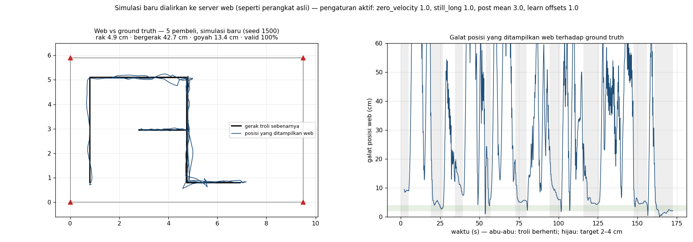

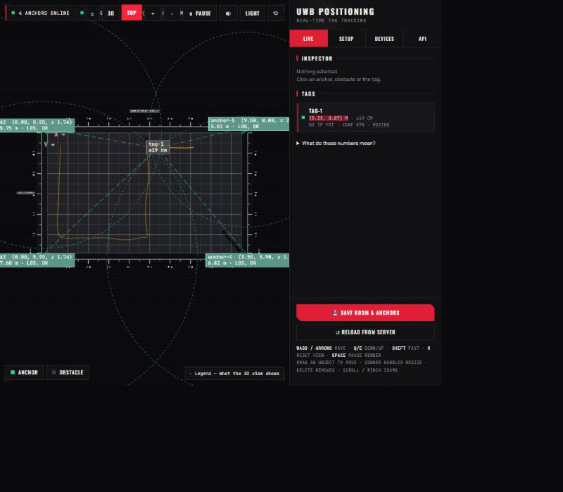

Menjalankan ulang (server harus sudah jalan):

```bash
python tools/sim_feed.py --world ramai --seed 1500 --server http://127.0.0.1:8090
```

## Lintasan: gerak troli sebenarnya vs posisi tiap algoritma

Garis hitam = gerak troli sebenarnya (ground truth). Garis berwarna = posisi yang ditampilkan,
semuanya dari data simulasi yang sama. Ada 16 algoritma per dunia, termasuk BZ-EKF dan bayangan
badan arah acak, satu rute demo. Gambar yang sama ada di sheet "Lintasan vs ground truth" di
Excel. Angka di judul = rata-rata 20 rute.

Versi angkanya ada di sheet **"Ground truth vs estimasi"**. Untuk setiap titik berhenti di rute
demo ketiga dunia, isinya:

- x, y sebenarnya;
- x, y dan galat dari 6 algoritma: G, C, web, web + kalibrasi, + B, + R;
- di bawahnya, rata-rata, P95, dan % ≤ 4 cm dari 20 rute.


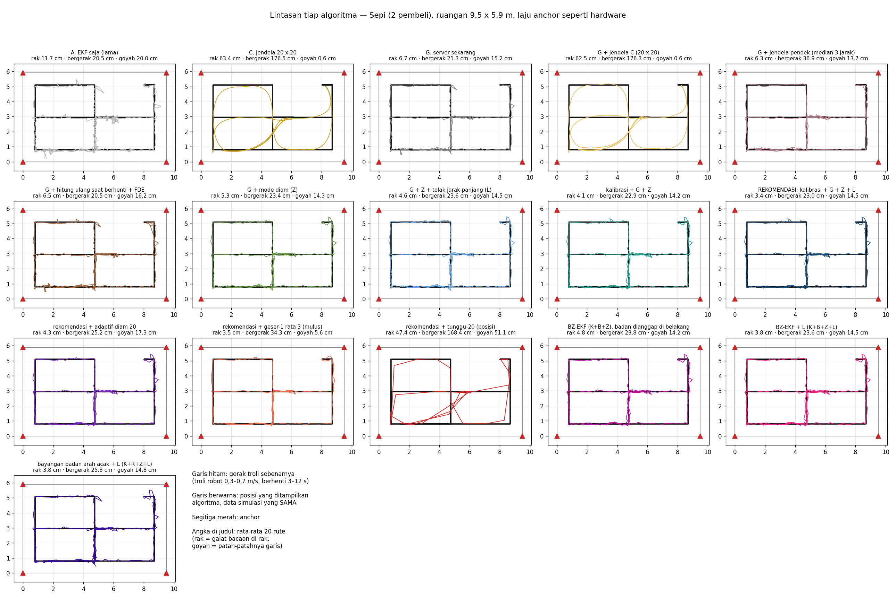

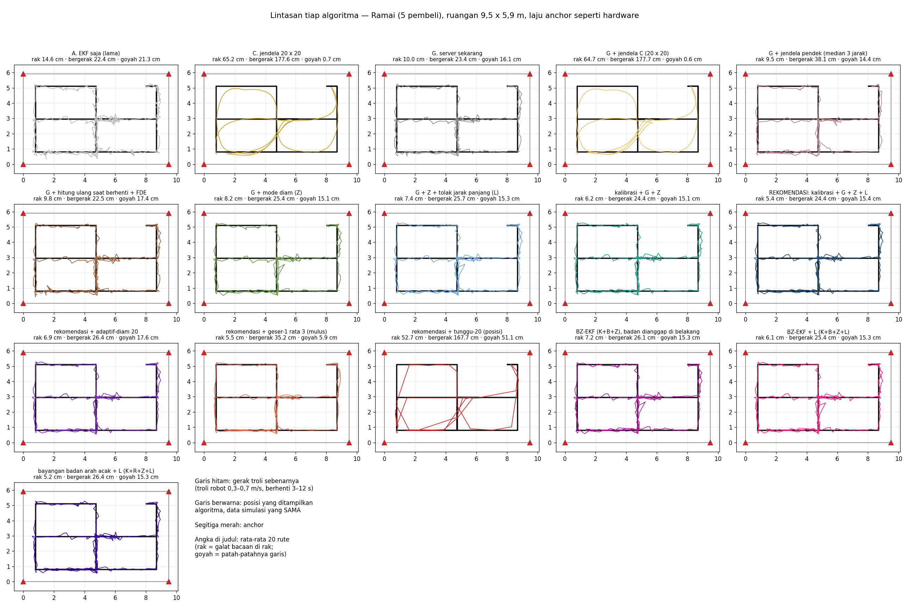

**Yang terlihat:**

- **C dan G + jendela C** sangat mulus, tapi memotong sudut lorong dan tertinggal jauh dari garis
  hitam.
- **tunggu-20** melompat-lompat dari titik ke titik.
- **Rekomendasi** menempel ke garis hitam. Saat bergerak masih bergerigi ±20 cm karena laju data.
- **rekomendasi + geser-1 rata 3** lebih mulus, tapi tertinggal sedikit di belokan.

## Animasi

Isi animasi:

- troli robot (kotak) dan pembeli (bulatan oranye, ukuran asli);
- jalur tag–anchor yang terhalang (merah);
- posisi dari G, C, dan dua kombinasi pilihan;
- grafik galat di bagian bawah.

| | GIF | MP4 |
|---|---|---|
| Dunia ramai | [`jendela_animasi.gif`](jendela_animasi.gif) | [`jendela_animasi.mp4`](jendela_animasi.mp4) |
| Dunia kosong (tanpa pedestrian) | [`jendela_animasi_kosong.gif`](jendela_animasi_kosong.gif) | [`jendela_animasi_kosong.mp4`](jendela_animasi_kosong.mp4) |

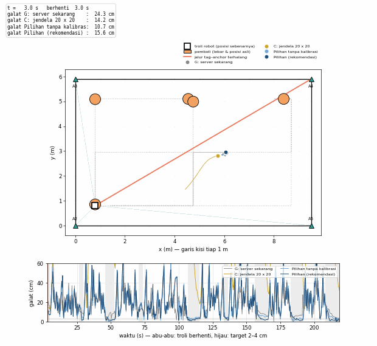

## Cara menjalankan ulang

```bash
python tools/window_study.py --runs 20    # ±20 menit: semua kombinasi -> jendela.json
python tools/window_report.py             # gambar, animasi, Hasil_Jendela.xlsx
```

## Istilah

- **Bacaan di rak:** galat rata-rata pada detik terakhir setiap berhenti ≥ 2 s, yaitu posisi yang
  dipakai untuk tahu troli ada di depan rak mana.
- **Goyangan saat berhenti:** seberapa jauh posisi bergoyang di sekitar rata-ratanya pada detik
  itu (kestabilan).
- **Kegoyahan garis:** seberapa patah-patah garis lintasan. Nilainya 0 untuk garis lurus yang
  mulus.
- **Galat bergerak:** galat terhadap posisi troli pada saat yang sama, selama troli berjalan.
- **Mode diam (Z):** saat troli diam, EKF menganggap kecepatannya 0 dan memperkecil derau proses.
- **Tolak jarak kepanjangan (L):** lihat [Yang dikombinasikan](#yang-dikombinasikan).
- **Kalibrasi statis (K):** offset jarak tiap anchor diukur sekali dengan tag di titik yang
  diketahui.
- **S / S+FDE:** posisi dihitung ulang dari median jarak tiap anchor sejak berhenti; FDE membuang
  satu anchor yang tidak cocok dengan yang lain.
