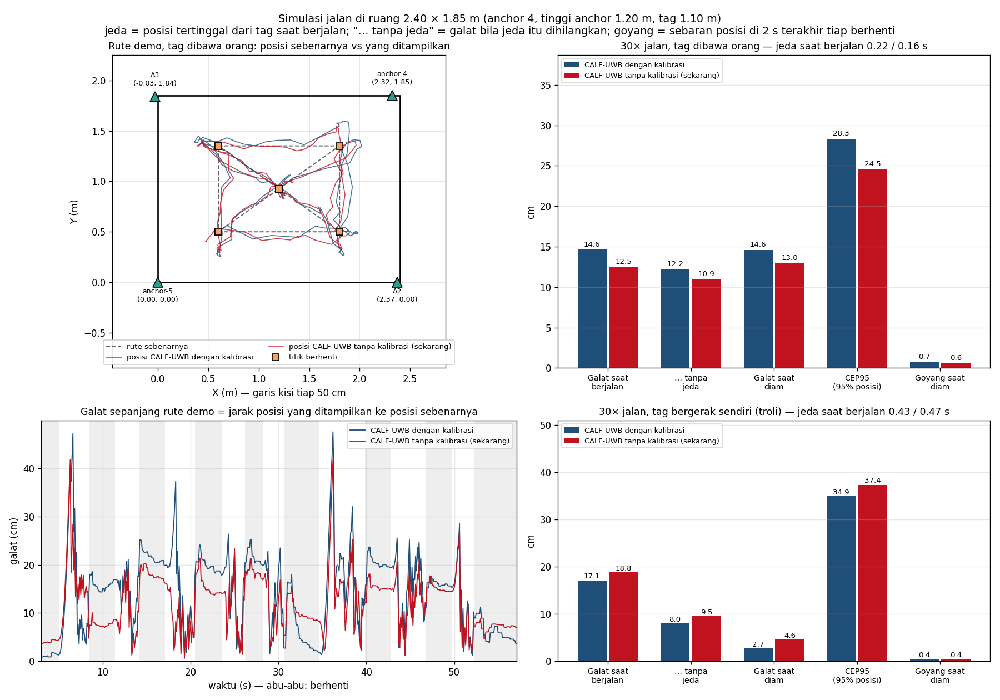
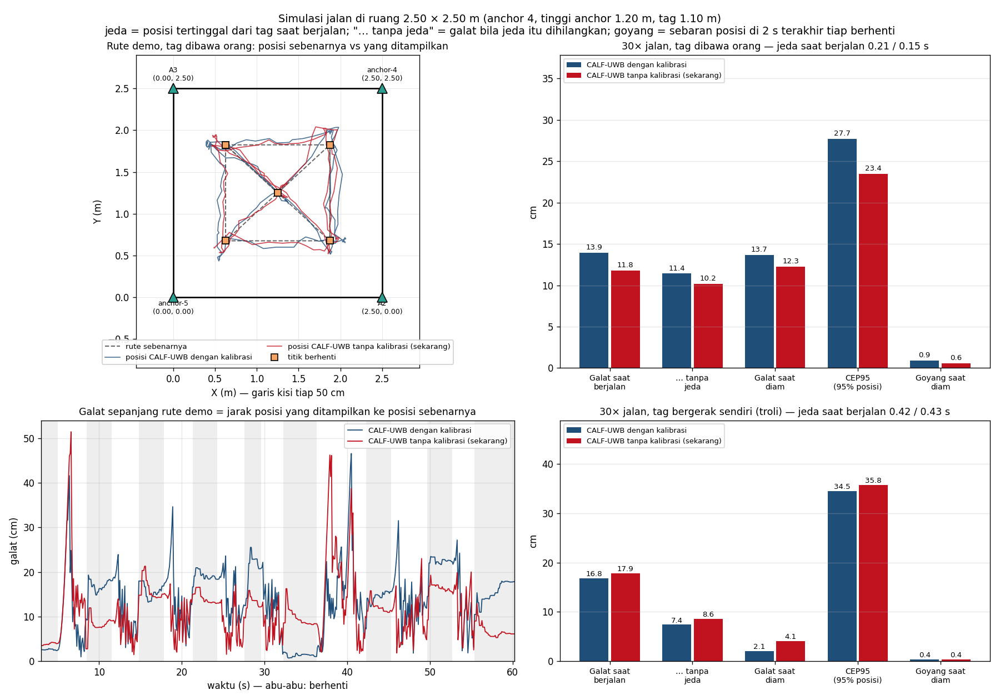
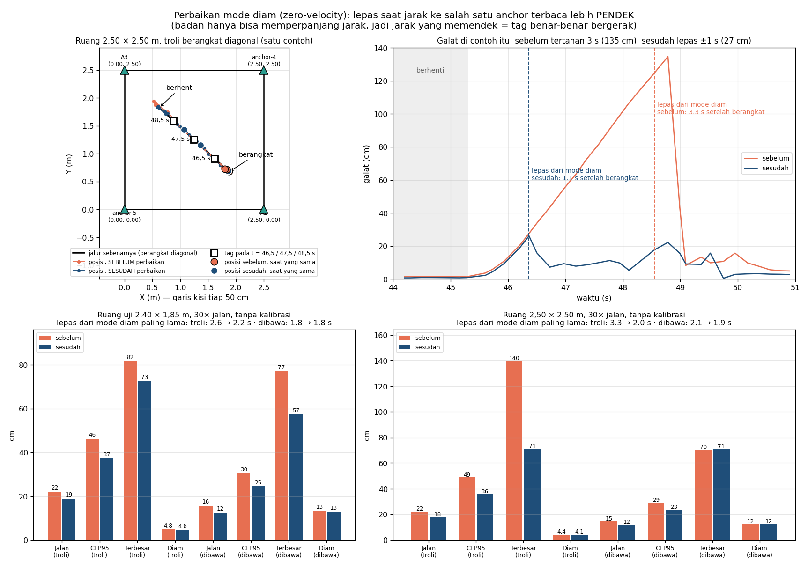

# Simulasi jalan di ruang uji (2,40 × 1,85 m) dan ruang 2,50 × 2,50 m

Simulasi dengan posisi anchor, tinggi anchor (1,20 m) dan tinggi tag (1,10 m)
dari denah server sekarang (`server/scene.json`). Untuk ruang 2,50 × 2,50 m,
setiap anchor dipindah ke sudut yang sama di ruangan itu.

Algoritmanya kode server sendiri (`server/tracker.py`, CALF-UWB), dijalankan
dua kali pada data jarak yang sama:
- **dengan kalibrasi**: offset tiap anchor diketahui ±2 cm;
- **tanpa kalibrasi**: offset dipelajari sambil berjalan, seperti ruangan
  sekarang.

```bash
python tools/room_walk.py                                         # ruang uji, ±5 menit
python tools/room_walk.py --room 2.5x2.5 --name ruang_250x250     # ruang lain
```

## Rute dan model radio

- **Rute:** satu putaran, lalu ke tengah, lalu diagonal.
  - Ruang uji: 8,6 m dalam 57 s. Ruang 2,5 m: 10,2 m dalam 60 s.
  - 9 titik berhenti 2–5 s, kecepatan maksimum 0,5 m/s, percepatan 0,5 m/s².
  - Rutenya sama setiap kali jalan; hanya derau radionya yang berbeda.
- **Model radio**, diambil dari pengukuran hardware di ruang uji (firmware
  1.0.37, robust round nyala):
  - 4,8 putaran ranging/s, tiap anchor 3,2 jarak/s;
  - derau jarak 2,5 cm (tag diam terukur 1,5–3 cm), dibulatkan per cm;
  - antenna delay +50–85 cm per anchor;
  - < 1 m dari anchor, jarak terbaca sampai 12 cm lebih pendek;
  - 2 % pantulan (+30–100 cm).
- **Dua dunia:**
  - **dibawa orang**: badan pembawa menambah 10–20 cm ke anchor di belakangnya;
  - **troli**: tag bergerak sendiri, tanpa badan, seperti troli otomatis nanti.

## Hasil (30× jalan per dunia, cm)

Dengan perbaikan mode diam (lihat bagian berikutnya).

| Ruang | Dunia | Varian | Jalan | Tanpa jeda | Jeda (s) | Diam | CEP95 | Terbesar | Goyang |
|---|---|---|---|---|---|---|---|---|---|
| 2,40 × 1,85 | dibawa orang | dengan kalibrasi | 14,6 | 12,2 | 0,22 | 14,6 | 28,3 | 55,9 | 0,7 |
| 2,40 × 1,85 | dibawa orang | tanpa kalibrasi | 12,5 | 10,9 | 0,16 | 13,0 | 24,5 | 57,4 | 0,6 |
| 2,40 × 1,85 | troli | dengan kalibrasi | 17,1 | 8,0 | 0,43 | **2,7** | 34,9 | 71,8 | 0,4 |
| 2,40 × 1,85 | troli | tanpa kalibrasi | 18,8 | 9,5 | 0,47 | 4,6 | 37,4 | 72,5 | 0,4 |
| 2,50 × 2,50 | dibawa orang | dengan kalibrasi | 13,9 | 11,4 | 0,21 | 13,7 | 27,7 | 68,2 | 0,9 |
| 2,50 × 2,50 | dibawa orang | tanpa kalibrasi | 11,8 | 10,2 | 0,15 | 12,3 | 23,4 | 70,8 | 0,6 |
| 2,50 × 2,50 | troli | dengan kalibrasi | 16,8 | 7,4 | 0,42 | **2,1** | 34,5 | 73,3 | 0,4 |
| 2,50 × 2,50 | troli | tanpa kalibrasi | 17,9 | 8,6 | 0,43 | 4,1 | 35,8 | 70,9 | 0,4 |

- **Ruang uji:**

  

  Animasi: [`ruang_uji_animasi_orang.gif`](ruang_uji_animasi_orang.gif),
  [`ruang_uji_animasi_troli.gif`](ruang_uji_animasi_troli.gif) (MP4 dengan nama
  yang sama).
- **Ruang 2,50 × 2,50 m:**

  

  Animasi: [`ruang_250x250_animasi_orang.gif`](ruang_250x250_animasi_orang.gif),
  [`ruang_250x250_animasi_troli.gif`](ruang_250x250_animasi_troli.gif).

Animasi berjalan 2× waktu nyata. Garis abu-abu tebal adalah rencana rute
(angka = urutan berhenti) dan garis hitam adalah jalur yang sudah dilewati tag.

## Perbaikan mode diam: lepas saat jarak memendek

Simulasi ruang 2,5 m menemukan bahwa saat troli **berangkat diagonal** dari
titik berhenti, posisi bisa tertahan sampai 3 s. Selama itu troli sudah
berjalan 1,3 m, galatnya sampai 140 cm, padahal tracker masih melaporkan
margin error ±5 cm.

- **Penyebab.** Mode diam hanya dilepas bila 3 dari 4 jarak terakhir tidak
  cocok dengan posisi.
  - Jarak ke dua anchor di samping hampir tidak berubah.
  - Jarak ke anchor di belakang (memanjang) dibuang sebagai "badan".
  - Akibatnya paling banyak 2 dari 4 jarak yang tidak cocok.
- **Perbaikan** (`server/tracker.py`, `ZUPT_EXIT_SHORT*`, `ZUPT_HOLD_MS`):
  - mode diam juga dilepas bila 2 dari 10 jarak terakhir lebih **pendek**
    dari perkiraan lebih dari 1σ;
  - badan atau halangan hanya bisa memperpanjang jarak, jadi jarak yang
    memendek berarti tag benar-benar bergerak;
  - setelah lepas, mode diam tidak masuk lagi selama 1 s.



| Ruang, tanpa kalibrasi | Jalan (troli) | CEP95 (troli) | Terbesar (troli) | Diam (troli) | Lepas paling lama (troli) |
|---|---|---|---|---|---|
| 2,40 × 1,85 sebelum | 22,0 | 46,2 | 81,6 | 4,8 | 2,6 s |
| 2,40 × 1,85 sesudah | 18,8 | 37,4 | 72,5 | 4,6 | 2,2 s |
| 2,50 × 2,50 sebelum | 22,2 | 48,8 | 139,6 | 4,4 | 3,3 s |
| 2,50 × 2,50 sesudah | 17,9 | 35,8 | 70,9 | 4,1 | 2,0 s |

- **Saat diam tidak berubah:** galat diam dan goyang sama seperti sebelumnya.
- **Rekaman asli (11 rekaman, termasuk sesi A/B/C dan rekaman malam 20 menit):**
  - sebaran posisi saat diam tetap sama;
  - semua pelepasan baru terjadi saat tag memang bergerak (menurut jarak
    mentah), tidak ada yang terjadi saat tag diam.
- **Sisa galat terbesar (±70 cm).** Terjadi bila anchor di depan troli
  kehilangan beberapa putaran berturut-turut (±1 s tanpa jarak). Tanpa data
  dari arah itu, gerakannya memang belum terlihat.

## Artinya

- **Saat diam (troli): 2–3 cm dengan kalibrasi, 4–5 cm tanpa.** Kalibrasi
  membantu, asal tidak ada badan di dekat tag.
- **Ruang 2,5 × 2,5 m sedikit lebih baik dari ruang uji** (diam 2,1 vs 2,7 cm),
  karena bentuknya persegi. Bedanya kecil. Ukuran ruangan bukan masalah utama;
  yang lebih penting posisi anchor terukur tepat dan tidak ada badan di dekat
  tag.
- **Saat dibawa orang, galat diam naik ke 12–15 cm.** Penyebabnya badan
  pembawa, bukan algoritmanya: badan menghalangi anchor di belakangnya,
  sehingga jarak ke anchor itu terbaca 10–20 cm lebih panjang.
  - Untuk menguji akurasi, taruh tag di atas kotak atau troli dan jauhkan
    badan, jangan dipegang di depan badan.
- **Saat berjalan galatnya 12–19 cm, sebagian besar karena jeda.** Posisi
  yang tampil tertinggal 0,15–0,5 s dari tag:
  - jarak terbaru paling lama satu putaran;
  - telemetri dikirim tiap 200 ms dan sampai 20–170 ms kemudian;
  - saat mulai bergerak, filter menunggu sampai jarak benar-benar menunjukkan
    gerakan.

  Bila jeda itu dihilangkan, galat troli tinggal 7–10 cm.
- **Goyang saat diam < 1 cm:** posisi diam sangat stabil, sesuai dengan uji
  diam di hardware (CEP95 1,3–1,7 cm).

## Batasan

- Posisi anchor dan tinggi tag dianggap tepat. Di ruangan nyata, salah ukur
  posisi anchor atau tinggi langsung menambah galat. Uji titik asli sebelum
  anchor diukur ulang memberi galat 19–27 cm tanpa kalibrasi.
- Pantulan dinding dimodelkan acak (2 %), bukan dari bentuk ruangan.
