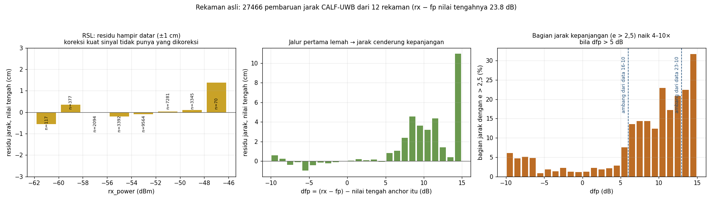
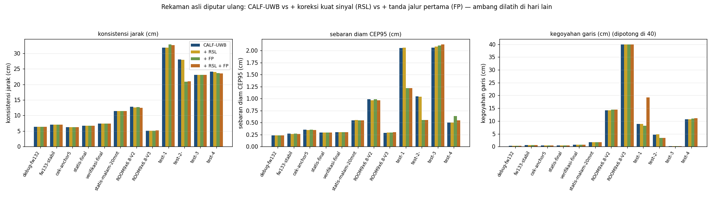
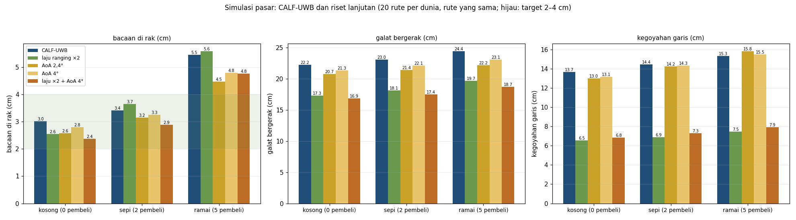
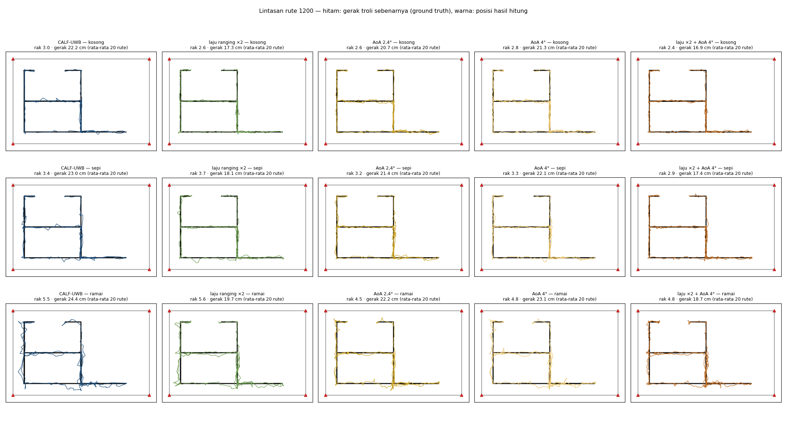

# Riset lanjutan: improved TWR dan AoA di atas CALF-UWB

> **Status: riset, tidak dipakai server.** Setiap ide dipasang **di atas**
> CALF-UWB yang sama persis dengan di server (`server/tracker.py`), lalu
> dibandingkan dengan CALF-UWB tanpa ide itu.
>
> - Kode: `tools/riset_lanjutan.py` (`real`, `sim`, `report`).
> - Hasil: `riset_lanjutan_rekaman.json`, `riset_lanjutan_simulasi.json`,
>   [`Hasil_Riset_Lanjutan.xlsx`](Hasil_Riset_Lanjutan.xlsx), dan gambar
>   `lanjutan_*.png` di folder ini.

## Ringkasan

| Ide | Hardware baru? | Hasil | Keputusan |
|---|---|---|---|
| **Koreksi bias kuat sinyal (RSL)** | Tidak | Residu jarak datar (±1 cm) di seluruh rentang kuat sinyal; hasil tidak berubah | **Tidak bermanfaat** di data ini |
| **Tanda jalur pertama lemah (FP)** | Tidak | Rekaman 23-10: sebaran diam CEP95 1,41 → 1,13 cm, kegoyahan 6,1 → 5,7 cm. Rekaman 16-10 tidak berubah | **Menjanjikan, belum terbukti**: perlu uji dengan ground truth |
| **Laju ranging ×2** | Tidak (pengaturan firmware) | Simulasi: galat bergerak −4,7 sampai −4,9 cm (−21%), kegoyahan tinggal setengah; bacaan di rak hampir sama | **Paling menjanjikan untuk troli bergerak**; perlu dicek apakah firmware sanggup |
| **AoA 2,4°** | Ya (4 anchor dua antena, keluarga DW3000) | Simulasi: bacaan di rak −1,0 cm hanya di dunia ramai; galat bergerak −1,5 sampai −2,2 cm | **Tidak dilanjutkan**: manfaat kecil untuk biaya hardware |
| **AoA 4°** | Ya | Bacaan di rak −0,7 cm di dunia ramai; lainnya tidak nyata | Tidak dilanjutkan |
| **Laju ×2 + AoA 4°** | Ya | Galat bergerak hampir sama dengan laju ×2 saja; bacaan di rak 0,2–0,8 cm lebih baik dari laju ×2 | Tidak dilanjutkan |

**Kesimpulan:**
- CALF-UWB tetap seperti sekarang.
- Kalau mau melanjutkan, ada dua yang tidak butuh hardware tambahan:
  1. coba laju ranging lebih tinggi di firmware;
  2. uji tanda jalur pertama (FP) dengan titik terukur saat ada orang lewat.

---

## Cara menguji

### Rekaman asli (RSL dan FP)

- **Data:** 12 rekaman `server/logs/*.jsonl` yang punya jarak mentah. Isinya
  27 466 pembaruan jarak, masing-masing lengkap dengan `rx_power` dan
  `fp_power` dari firmware.
- **Tidak ada ground truth.** Rekaman ini tidak punya titik terukur. Yang
  dibandingkan hanya yang bisa diukur jujur:
  - sebaran saat diam (CEP95);
  - konsistensi posisi dengan jarak terukur;
  - kegoyahan garis;
  - ketersediaan (valid).
- **Tidak menilai pakai data latih sendiri.** Kurva RSL dan ambang FP dicari
  dari rekaman **satu hari**, lalu diuji pada rekaman **hari yang lain**
  (16-10 ↔ 23-10).

### Simulasi (laju ×2 dan AoA)

- **Dunia:** sama dengan studi jendela. Troli robot berjalan sendiri di
  antara 0 / 2 / 5 pembeli, 20 rute per dunia, dan **rute yang sama** untuk
  setiap varian.
- **Varian AoA:** jaraknya persis sama dengan CALF-UWB. Hanya sudut yang
  ditambahkan.
- **Perbandingan berpasangan:** selisih tiap varian dihitung per rute,
  ± 2 galat baku. Selisih yang lebih kecil dari ± itu **belum terbukti
  nyata**.

---

## 1. Koreksi bias menurut kuat sinyal (RSL)

**Idenya.** Menurut catatan aplikasi Decawave APS011, bias jarak DW1000
bergantung pada kuat sinyal. Kurva `bias(rx_power)` dicari dari data, lalu
dikurangkan dari setiap jarak (lapisan 1, koreksi).



**Hasil:**
- Nilai tengah residu CALF-UWB per 2 dB `rx_power` hanya −0,6 sampai +0,3 cm
  di −61 sampai −49 dBm. Hanya kelompok −47 dBm yang +1,4 cm, dan isinya
  cuma 70 sampel.
- Akibatnya kurva koreksinya hampir nol, dan semua ukuran tidak berubah
  (selisih ≤ 0,2 cm).

**Kenapa tidak ada yang dikoreksi:**
- Rentang kuat sinyal di rekaman sempit (14 dB), karena ruangan kecil.
- Bagian yang konstan sudah diserap kalibrasi dan offset tiap anchor (b, dᵢ).
- Angka daya dari library DW1000 tidak bisa dipakai apa adanya. Contohnya,
  `rx_power − fp_power` bernilai 23,8 dB bahkan di ruangan kosong. Padahal
  menurut aturan praktis Decawave, selisih < 6 dB berarti jalur bebas. Jadi
  tabel APS011 tidak bisa diterapkan langsung.

**Keputusan:** tidak dilanjutkan.

## 2. Tanda jalur pertama lemah (FP)

**Idenya.** Kalau jalur pertama (langsung) jauh lebih lemah dari sinyal
keseluruhan, jalurnya mungkin terhalang. Jarak itu diberi σ lebih besar
(lapisan 2), jadi bobotnya turun. L hanya bekerja saat troli diam; tanda ini
juga bekerja saat troli bergerak.

**Ukurannya: `dfp`.**
- Rumusnya `(rx_power − fp_power)` dikurangi nilai tengahnya untuk anchor itu.
- Pengurangan ini perlu karena angka mutlaknya tidak bisa dipercaya (lihat §1).
- Untuk pemakaian live, nilai tengah ini harus dihitung berjalan.

**Temuan di rekaman (gambar di atas, kanan):**
- Bila dfp ≤ +4 dB, hanya 1–3% jarak yang kepanjangan (e > 2,5).
- Bila dfp > +5 dB, angkanya naik menjadi 8–32%, dan nilai tengah residunya
  +1 sampai +5 cm.
- Jadi tanda ini **memang** menunjuk jarak yang kepanjangan.

**Aturan yang diuji:**
- Bila dfp > ambang, σ jarak itu dibuat ×3 (bobot 1/9).
- Ambang = kelompok dfp terendah yang bagian jarak kepanjangannya ≥ 3× rata-rata.
- Ambang yang didapat **berbeda antar hari**:
  - dari data 16-10 → 6 dB;
  - dari data 23-10 → 13 dB.

| Rekaman 23-10 (ambang dari data 16-10) | CEP95 diam | Konsistensi jarak | Kegoyahan | Jarak ditandai |
|---|---|---|---|---|
| test-1, CALF-UWB / + FP | 2,1 / **1,2** cm | 31,8 / 32,9 cm | 8,8 / **8,2** cm | 14,9% |
| test-2 | 1,0 / **0,6** cm | 28,0 / **20,9** cm | 4,7 / **3,4** cm | 4,8% |
| test-3 | 2,1 / 2,1 cm | 23,1 / 23,1 cm | 0,2 / 0,2 cm | 25,3% |
| test-4 | 0,5 / 0,6 cm | 24,1 / 23,6 cm | 10,7 / 11,0 cm | 19,2% |
| **Rata-rata** | **1,41 / 1,13 cm** | **26,7 / 25,1 cm** | **6,1 / 5,7 cm** | 16% |



**Catatan:**
- Rekaman 16-10 (ruangan kecil, tidak ada orang lalu-lalang) tidak berubah.
  Ambang dari data 23-10 (13 dB) hanya menandai 0,6% jarak.
- Konsistensi jarak di rekaman 23-10 (±25 cm) didominasi koordinat anchor
  yang salah (anchor-4 +21 cm, anchor-5 −18 cm), bukan oleh algoritma.
- RSL + FP sekaligus membuat kegoyahan test-1 naik ke 19 cm. Kedua ide tidak
  saling menguatkan.

**Keputusan: menjanjikan, belum terbukti.** Rekaman ini tidak punya posisi
benar. Langkah berikutnya, tanpa hardware tambahan:
1. Rekam dengan tag di titik terukur, sementara seseorang lewat di antara tag
   dan anchor.
2. Bandingkan CALF-UWB dengan + FP terhadap titik itu.
3. Cari ambang dari rekaman di ruangan yang sama.

## 3. Laju ranging ×2

**Idenya.** Satu putaran ranging setiap 200 ms, bukan 400 ms. Ini 5 sampel per
anchor per detik, bukan 2,5. Yang diubah hanya pengaturan jeda protokol di
firmware, tanpa hardware tambahan.

| Dunia | Bacaan di rak: CALF-UWB → laju ×2 | Selisih (± 2 SE) | Galat bergerak | Kegoyahan | Rak ≤ 4 cm |
|---|---|---|---|---|---|
| Kosong | 3,0 → **2,6** cm | −0,47 ± 0,26 | 22,2 → **17,3** cm | 13,7 → **6,5** cm | 75 → 85% |
| Sepi | 3,4 → 3,7 cm | +0,24 ± 0,67 (tidak nyata) | 23,0 → **18,1** cm | 14,4 → **6,9** cm | 68 → 73% |
| Ramai | 5,5 → 5,6 cm | +0,13 ± 0,87 (tidak nyata) | 24,4 → **19,7** cm | 15,3 → **7,5** cm | 52 → 55% |

**Hasil:**
- Galat bergerak turun ±4,8 cm (−21%). Ini terjadi di **20 dari 20 rute** di
  setiap dunia.
- Kegoyahan garis tinggal setengah.
- Bacaan di rak hanya membaik di dunia kosong. Alasannya, saat berhenti mode
  diam sudah merata-ratakan banyak sampel. Galat dari badan pembeli adalah
  **bias**, bukan derau, jadi tidak hilang hanya karena sampelnya lebih banyak.

**Keputusan: paling menjanjikan untuk troli bergerak.** Yang perlu dicek di
hardware:
- apakah library DW1000 sanggup satu putaran 4 anchor dalam 200 ms;
- apakah WiFi sanggup paket yang dua kali lebih besar.

### Kenapa hardware sekarang hanya ±2,5 jarak/anchor/detik

Diukur dengan `tools/ranging_rate.py` dari rekaman yang ada:

| Tahap | Per anchor per detik | Penjelasan |
|---|---|---|
| Jadwal POLL library | **5,8** (teori) | Tag mengirim POLL tiap `80 + 3 × 4 × 7` = 164 ms |
| Jarak yang dihitung anchor | 2,6–3,6 | Separuh putaran gagal sebelum anchor menghitung |
| Jarak yang sampai ke tag | 1,9–3,1 | 20–30% lagi hilang: RANGE_REPORT dari anchor ke tag |
| …yang mustahil | 4–7% | Jarak puluhan meter |

Dua penyebab di `lib/DW1000/src/DW1000Ranging.cpp`:

1. **Tag hanya mengirim RANGE kalau POLL_ACK anchor *terakhir* datang.** Satu
   POLL_ACK dari anchor itu hilang, maka putaran gagal untuk keempat anchor.
2. **Anchor yang POLL_ACK-nya tidak diterima tag tetap diberi cap waktu
   putaran sebelumnya.** Anchor itu lalu menghitung dari pasangan cap waktu
   yang tidak cocok. Ini kemungkinan besar asal jarak mustahil.

Jadi laju ×2 tidak butuh jam yang lebih cepat. Cukup kurangi putaran yang gagal.

### Uji di hardware: ronde robust (firmware 1.0.37 di tag, default mati)

**Yang diubah (hanya di tag; anchor tidak berubah).** Tag mengirim RANGE:
- begitu POLL_ACK anchor terakhir datang, seperti biasa; **atau**
- paling lambat 78 ms setelah POLL (dengan 4 anchor): slot terakhir 49 ms,
  ditambah ruang untuk jeda loop anchor.

POLL_ACK yang datang lebih lambat dari itu tidak masuk putaran ini, tetapi
tetap dihitung sebagai tanda anchor masih hidup. Versi pertama (1.0.36, batas
65 ms, tanpa itu) membuat anchor terbuang. Tag juga melaporkan waktu
kedatangan POLL_ACK tiap anchor (`ack_ms`) dan anchor yang terbuang
(`anchors_dropped`); `tools/ranging_rate.py` mencetak keduanya.

RANGE hanya berisi anchor yang menjawab putaran **ini**. Kode ada di
`DW1000Ranging::useRobustRound`; bila mati, protokolnya persis seperti
sebelumnya.

**Cara menyalakan (pilih satu):**
- **Lewat server:** jalankan server dengan `--robust-round 1`.
  - Server lalu mengirim `uwb.robust_round` ke semua node.
  - Setiap node menyimpan nilai baru lalu restart sekali.
  - Tanpa flag ini server tidak mengirim apa-apa, jadi node memakai
    setelannya sendiri.
- **Lewat serial tag:** ketik `robust on`, lalu `save`.

Mematikan: `--robust-round 0`, atau `robust off` + `save`.

**Langkah uji:**
1. OTA semua node ke **1.0.37** atau lebih baru (tab Devices). Ronde robust
   masih mati.
2. Rekam sesi **A** (Setup → Record session): tag diam 2 menit, lalu
   jalan 2 menit.
3. Jalankan ulang server dengan `--robust-round 1`. Tunggu tag restart; di
   rekaman, status tag menunjukkan `robust: true`.
4. Rekam sesi **B** dengan rutinitas yang sama, di tempat yang sama.
5. Bandingkan laju ranging:
   ```bash
   python tools/ranging_rate.py server/logs/<A>.jsonl server/logs/<B>.jsonl
   ```
6. Bandingkan kestabilan posisinya:
   ```bash
   python tools/replay_compare.py server/logs/<A>.jsonl server/logs/<B>.jsonl
   ```

**Tanda berhasil:**
- jarak/anchor/detik naik dari ±2–2,8 menuju 4–5;
- "4 of 4" (putaran dengan keempat anchor) naik;
- jarak mustahil turun dari 4–7% menuju ±0.

Kalau malah turun, matikan lagi; tidak ada yang lain yang berubah.

**Patokan rekaman sekarang** (firmware 1.0.35, protokol asli):

| Rekaman | Jarak/anchor/detik | Putaran/detik (maks 5,8) | 4 dari 4 anchor | Jarak mustahil |
|---|---|---|---|---|
| test-1 | 2,14 | 3,44 | 20% | 7,4% |
| test-2 | 1,87 | 3,30 | 8% | 6,3% |
| test-4 | 2,56 | 3,83 | 23% | 5,4% |
| verifikasi-final | 2,78 | 3,92 | 33% | 4,4% |
| cek-laju-fw135 (25-10, ruangan 2,4 × 1,85 m) | 2,65 | 3,83 | 24% | 4,3% |

### Hasil uji hardware (25-10, ruangan 2,4 × 1,85 m, 4 anchor)

Urutan uji:
- Sesi A: protokol asli.
- Robust v1: batas 65 ms.
- Robust v2 (tag firmware 1.0.37): batas 78 ms, POLL_ACK yang terlambat
  tetap dihitung "anchor masih hidup".
- Sesi B: robust v2, 2 menit diam lalu 2 menit jalan.

| Rekaman | Jarak/anchor/detik | …tanpa jarak mustahil | Putaran/detik (maks 5,8) | 4 dari 4 anchor | Jarak mustahil |
|---|---|---|---|---|---|
| Sesi A (robust mati) | 3,02 | 2,88 | 4,07 | 33% | 4,7% |
| Robust v1, diam 45 s | 1,99 | 1,99 | 5,04 | 0% | 0% |
| Robust v2, diam 60 s | 2,89 | 2,89 | 4,66 | 18% | 0% |
| **Sesi B (robust v2)** | **3,20** | **3,20** | **4,80** | 19% | **0%** |

**Temuan:**
- **Penyebab 2 terbukti.** Jarak mustahil hilang total (4,7% → 0%) begitu
  anchor yang tidak menjawab tidak lagi diberi cap waktu putaran lalu.
- **Penyebab 1 hanya sebagian.**
  - Putaran yang menghasilkan jarak naik 18%.
  - Jarak yang sampai ke tag hanya naik 6% (11% kalau jarak mustahil di sesi A
    tidak dihitung). **Bukan ×2.**
- **Robust v1 merugikan.** Batas 65 ms terlalu cepat: anchor yang balasannya
  terlambat ikut dibuang dari daftar tag, lalu butuh 4–11 detik untuk kembali.
- **Batas sebenarnya ada di anchor.** Diagnostik `ack_ms` menunjukkan setiap
  anchor menjawab ±18 ms **setelah** slotnya:
  - slot 7 / 21 / 35 / 49 ms;
  - datang 25 / 39 / 53 / 67 ms.

  Itu jeda loop ESP32 di anchor (radio dilayani di loop, bukan di interrupt).
  Anchor hanya menyelesaikan ±3,5 dari 5,8 putaran per detik.
- **Posisi belum bisa dibandingkan dengan adil.**
  - Saat bergerak, sesi B lebih mulus: kegoyahan 4,4 vs 8,6 cm, lompatan
    terbesar 24 vs 82 cm.
  - Saat diam, sesi B lebih lebar: CEP95 3,3 vs 1,3 cm.
  - Tapi tag diam di tempat lain, dan rute jalannya berbeda (15 vs 29 m).
  - Untuk itu perlu uji diam bergantian di **titik yang sama**.

**Uji diam bergantian di titik yang sama (sesi C).**
- Tag tidak dipindah.
- Masing-masing 2 menit, keduanya dimulai tepat setelah server dan semua node
  restart.

| Sesi C | Jarak/anchor/detik | …tanpa jarak mustahil | Putaran/detik | 4 dari 4 | Jarak mustahil | CEP50 / CEP95 / maks | Valid |
|---|---|---|---|---|---|---|---|
| Robust mati | 3,13 | 3,00 | 4,16 | 36% | 4,3% | 0,75 / 1,72 / 2,0 cm | 100% |
| Robust nyala | 3,26 | **3,26** (+9%) | **4,84** | 21% | **0,1%** | 0,75 / **1,29** / **1,4** cm | 100% |

- Di titik yang sama, robust nyala sedikit lebih rapat: CEP95 1,72 → 1,29 cm.
- **Rata-rata posisinya bergeser ±11 cm antar dua rekaman**, padahal tag tidak
  dipindah. Ini bukan efek ronde robust:
  - kedua rekaman belum dikalibrasi, jadi offset tiap anchor dipelajari ulang
    setelah restart;
  - dari satu titik diam, offset tidak bisa dipisahkan dari posisi (§1 di
    ALGORITHMS.md).
- Mana yang benar hanya bisa dijawab dengan mengukur posisi tag pakai meteran,
  atau dengan kalibrasi.
- **Diukur meteran:** tag di (1,265; 0,245) m.

  | Sesi C | Rata-rata posisi | Galat |
  |---|---|---|
  | Robust mati | (1,145; 0,104) | 18,6 cm |
  | Robust nyala | (1,154; −0,005) | 27,3 cm |

  - Jarak mentah di kedua rekaman hampir sama persis (selisih per anchor < 2 cm).
    Jadi selisih galatnya berasal dari offset yang dipelajari ulang, **bukan**
    dari ronde robust.
  - Selisih jarak terukur − jarak benar per anchor, setelah offset bersama
    (+70 cm) dibuang: anchor-2 +22, anchor-3 −14, anchor-4 −1, anchor-5 −8 cm.
    Inilah yang harus dihilangkan kalibrasi statis (K) sebelum akurasi 2–4 cm
    bisa diuji.

**Kesimpulan sementara:**
- Ronde robust v2 aman dan sedikit membantu: lebih banyak jarak sah, tanpa jarak
  mustahil, tanpa anchor yang terbuang.
- Laju ×2 tidak bisa dicapai lewat protokol saja selama anchor menjawab ±18 ms
  terlambat. Langkah berikutnya yang mungkin:
  - mengurangi jeda loop anchor (misalnya layar OLED dimatikan);
  - melayani radio lebih cepat (perlu perubahan firmware yang lebih dalam).

Saat sebuah node restart di tengah rekaman, jamnya mulai dari 0 lagi. Skrip
menghitung waktu per sesi nyala, dan mencetak node mana yang restart.

**Jangan ubah pengaturan saat merekam.** Mengubah tinggi tag atau posisi
anchor membuat server mengirim config baru, dan semua node restart.

## 4. AoA (sudut datang)

**Model:**
- Setiap anchor mengukur arah datang sinyal tag (PDoA, dua antena).
- Galat sudut 2,4° (terbaik yang dilaporkan) atau 4°.
- Galat sudut 15° bila badan menghalangi, karena sudutnya lalu berasal dari
  pantulan.
- Sudut masuk ke EKF CALF-UWB sebagai pengukuran tambahan di lapisan 2
  (`h = atan2(y − yᵢ, x − xᵢ)`), dengan bobot Huber yang sama.

| Dunia | Rak: CALF-UWB → AoA 2,4° | Selisih (± 2 SE) | AoA 4° | Selisih | Galat bergerak (2,4°) |
|---|---|---|---|---|---|
| Kosong | 3,0 → **2,6** cm | −0,44 ± 0,29 | 2,8 cm | −0,22 ± 0,23 (tidak nyata) | 22,2 → 20,7 cm |
| Sepi | 3,4 → 3,2 cm | −0,26 ± 0,29 (tidak nyata) | 3,3 cm | −0,15 ± 0,25 (tidak nyata) | 23,0 → 21,4 cm |
| Ramai | 5,5 → **4,5** cm | −0,99 ± 0,58 | **4,8** cm | −0,66 ± 0,44 | 24,4 → 22,2 cm |

**Kenapa manfaatnya kecil:**
- Pada jarak 5 m, galat sudut 2,4° sama dengan ±21 cm ke samping. Itu jauh
  lebih kasar dari jarak UWB bila 4 anchor terlihat.
- Sudut hanya membantu saat beberapa jarak terhalang badan (dunia ramai).

**Keputusan: tidak dilanjutkan.**
- Butuh 4 anchor dengan dua antena (keluarga DW3000). Ini bertentangan dengan
  syarat tanpa hardware tambahan.
- Ditambah laju ×2, AoA 4° hanya menambah 0,2–0,8 cm di rak.



## Lintasan terhadap ground truth

Rute 1200 di ketiga dunia. Garis hitam = gerak troli sebenarnya; garis
berwarna = posisi hasil hitung tiap varian.



## Mengulang

```bash
python tools/riset_lanjutan.py real      # rekaman asli, ±10 menit
python tools/riset_lanjutan.py sim       # simulasi, 20 rute x 3 dunia x 5 varian
python tools/riset_lanjutan.py report    # gambar + Excel
```
